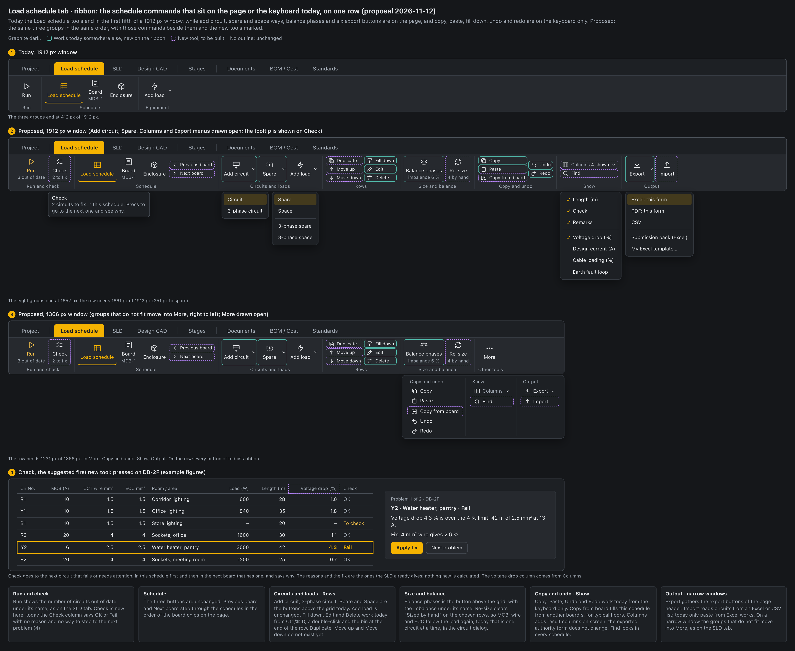

# UI UX proposal – Load schedule ribbon (2026-11-12)

Status: **proposal, nothing built.** Waiting for the user's answers to the questions at the end.

Mockup: `docs/mockups/load-schedule-ribbon-mockup.html` (image: `load-schedule-ribbon-mockup.png`).

## Today

The Load schedule tab shows Run, Schedule (Load schedule, Board, Enclosure) and Equipment (Add load) (`src/components/Ribbon.tsx`, the `schedule: [run, […], equipment]` tools). On a 1912 px window the three groups end at about 412 px, so four fifths of the row is empty. The schedule commands that are not on the row:

- Add circuit, Add 3-phase circuit, Spare, Space (with a 3-phase tick) and Balance phases are buttons above the grid (`LoadScheduleView.tsx`).
- The page header holds six export buttons: Excel and PDF of this form, the DB schedule PDF, CSV, Submission pack (Excel) and My Excel template….
- Copy, paste from Excel and fill down work from the keyboard only (`useExcelGrid.ts`). Undo and Redo: keyboard or the command palette.
- A circuit is edited by a double-click on its row and deleted with the bin at the end of the row.
- The Check column says OK or Fail without a reason. The reasons and the quick fixes exist (`src/calc/quickFix.ts`); only the SLD shows them.
- "Sized by hand" is cleared one circuit at a time, in the circuit dialog.
- Not in the app at all: duplicate a row, move a row, find, choose columns, copy a schedule from another board, import from a file.

## Proposed

The three groups keep their order and every button they have. Rule, as on the SLD tab: a button is either a command that works today or it is marked new and appears only when its tool is built.

| Group | On the ribbon | Where it is today |
|---|---|---|
| Run and check | Run with "3 out of date" under it; **Check** with "2 to fix" (**new tool**, below) | Count: Run's tooltip. Check: SLD tab only |
| Schedule | Load schedule, Board, Enclosure · Previous board, Next board (**new**) | Unchanged; the board chips on the page |
| Circuits and loads | **Add circuit** menu: Circuit, 3-phase circuit · **Spare** menu: Spare, Space, 3-phase spare, 3-phase space · Add load (unchanged) | Buttons above the grid |
| Rows | Fill down, Edit, Delete · Duplicate, Move up, Move down (**new**) | Ctrl/⌘ D, double-click, the row's bin |
| Size and balance | Balance phases with the imbalance under it · Re-size (**new**) | Button and readout above the grid |
| Copy and undo | Copy, Paste, Undo, Redo · Copy from board (**new**) | Keyboard only |
| Show | Columns (**new**) · Find (**new**) | – |
| Output | Export menu: Excel, PDF and CSV of this form, Submission pack (Excel), My Excel template… · Import (**new**) | Page header |

Narrow windows: groups that do not fit move into More under their own headings, right to left, as built for the SLD tab in v2.108.

Widths, measured on the mockup with the app's button sizes:

| Row | Needs | Window |
|---|---|---|
| Today | 412 px | 1912 px |
| Proposed | 1661 px (251 px to spare) | 1912 px |
| Proposed, narrow | 1231 px, with Copy and undo, Show and Output in More | 1366 px |

## New tools

**Check (suggested first).** One press goes to the next circuit that fails or needs attention, in this schedule first and then in the next board that has one. It marks the row and says why, with the fix: for example "Voltage drop 4.3 % is over the 4 % limit. Fix: 4 mm² wire gives 2.6 %", with Apply fix and Next problem. The reasons and fixes are the ones the SLD already gives (`failReasons`, `quickFixes`); nothing new is calculated. Drawn as strip 4 of the mockup with example figures.

**Copy from board.** Fills this schedule from another board's circuits, for typical floors. Today a board can be copied on the SLD with everything below it; a schedule cannot be copied into an existing board.

**Columns.** A tick list of the columns on screen. It adds result columns the app already calculates for every circuit: voltage drop, design current, cable loading, earth fault loop. Today Length is entered "calc only" and its result is not shown in the schedule. On screen only; the exported authority form does not change.

**Duplicate, Move up, Move down.** A copy of the selected circuit in the next free way; move a circuit one way up or down and renumber.

**Find.** Type a circuit, room or load; the schedule that has it opens with the row marked. `searchEquipment` (`src/model/bulkEdit.ts`) already finds equipment by name.

**Re-size.** Clears "Sized by hand" on the chosen rows, or the whole board, after showing what will change, so MCB, wire and ECC follow the load again. The number sized by hand is shown under the button.

**Previous board, Next board.** Step through the schedules in the order of the board chips.

**Import.** Circuits from an Excel or CSV list into this schedule. Today only paste from Excel works. The largest of the new tools.

## What stays the same

- The order of the three groups and every existing button, name and icon. Only two captions change: Run becomes "Run and check" and Equipment becomes "Circuits and loads".
- On the page: the DB list, the form tabs (TCL summary, panel types, Busbar riser), the board chips, the Load schedule / Connected load & MD switch, the ELCB settings, the phase load readout, the grid and its keys.
- Every exported form.
- Every other ribbon tab.

## Suggested steps

1. Existing commands onto the row: the Run count, Add circuit, Spare, Fill down, Edit, Delete, Balance phases, Copy, Paste, Undo, Redo, Export, and the More overflow. The page tells the ribbon its selected rows and counts, as the SLD does since v2.108.
2. New tools, each with its button, one at a time: Check, Copy from board, Columns, Duplicate with Move up and Move down, Find, Re-size, Previous and Next board, Import.

## Decisions

Waiting for the user. A suggested answer is given for each.

1. After the move, do Add circuit, Spare, Space, Balance phases and the export buttons leave the page, or stay in both places? Suggested: **ribbon only**, as chosen for the SLD. One consequence: the page also opens from Documents → Load schedule, where the ribbon shows the Documents tools (`TAB_VIEWS.reports`), so that button would then switch to the Load schedule tab.
2. Which new tools to build, and in which order? Suggested: **the order of step 2.**
3. Add circuit and Add load side by side, or one button? Suggested: **both.** Add circuit takes the next free way of a DB; Add load adds a load by type (motor, solar PV, EV charger, feeder cable).
4. Are "Run and check", "Circuits and loads", "Rows", "Size and balance", "Copy and undo", "Show" and "Output" the right group names?
5. Narrow windows: move groups into More, as on the SLD tab? Suggested: **yes.**
6. Columns: on screen only, or also on the DB schedule PDF? Suggested: **screen only.**
