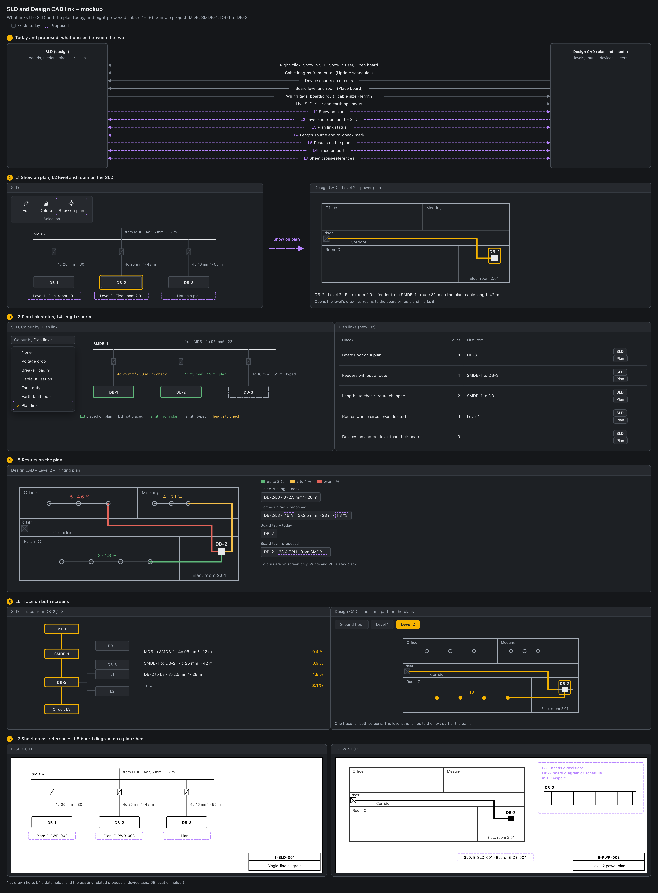
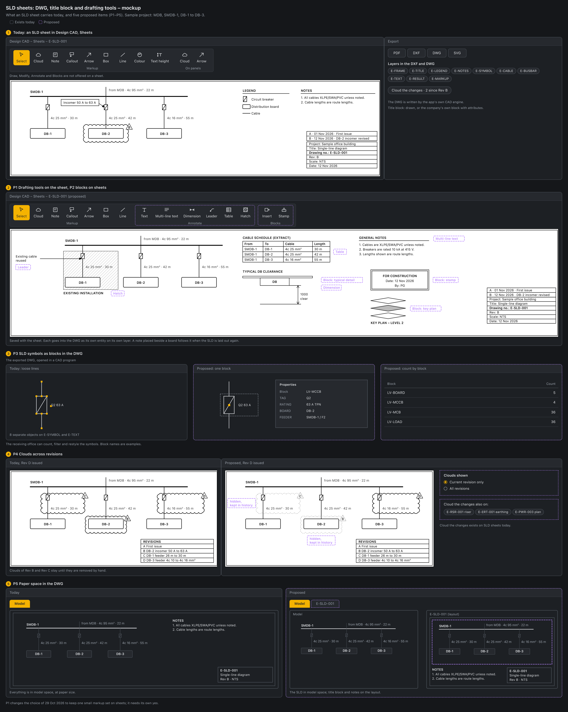

# UI UX proposal – SLD and Design CAD link (2026-11-12)

Status: **proposal, awaiting the user's decision**. Nothing here is built.

Mockup: `docs/mockups/sld-cad-link-mockup.html` (image: `sld-cad-link-mockup.png`).

## Today

The SLD and Design CAD read the same project, but the links run almost only one way: from the plan to the SLD.

What exists:

- **Plan to SLD, by right-click.** A device, board, tray or route on the plan offers Open board, Load schedule, Show in SLD and Show in riser (`src/components/cad/cadObjectMenus.ts`, `showFromCad` in `App.tsx`; v2.101).
- **Plan to model, as data.** Place board writes the board's position, level and room (`Board.planPoint`, `level`, `location`; `placeBoard` in `src/model/cadDevices.ts`). Update schedules proposes feeder lengths from the drawn routes: (route + vertical + terminations) × (1 + waste), rounded up to a metre (`pullCadLengths` in `src/model/cadLengths.ts`). The device count of a circuit follows the plan as devices are placed (`LvPoint.feederId`). Loads from blocks come through the Loads from CAD dialog.
- **Model to plan.** Wiring tags on home runs read board/circuit · cable size · length (`src/model/cadWiring.ts`). A board symbol carries its board's name.
- **Sheets.** Design CAD → Sheets holds the SLD, riser and earthing sheets and draws them live from the project (`CadSheets.tsx`, `src/components/docs/sheetRender.tsx`).

What is missing:

- **No way from the SLD to the plan.** No control on the SLD, the riser, Panels or the schedules opens Design CAD at a board or a route. The canvas can zoom to a window, a scale or the previous view (`ZoomReq` in `CadCanvas.tsx`), not to an object.
- **The SLD does not show where a board is.** Place board fills `level`, `location` and `planPoint`, but `SystemDiagram.tsx` and `SingleLineDiagram.tsx` never read them.
- **No view of what is linked.** Nothing lists the boards without a place, the feeders without a route, or the lengths that no longer match the plan. A feeder does not remember whether its length was typed or taken from the plan.
- **Calculation results stay on the SLD.** The plan shows cable size and length in the wiring tag, but not the breaker rating, the voltage drop or the loading.
- **Sheets do not point at each other.** An SLD sheet does not say which plan sheet shows a board, and the plan sheet does not name the SLD sheet.

## Proposed

Eight links, L1 to L8. Each can be built alone unless it says otherwise.

| | Link | Direction | What the engineer gets | Size |
|---|---|---|---|---|
| L1 | Show on plan | SLD to plan | From a board or feeder, open its level's drawing zoomed to it | Small |
| L2 | Level and room on the SLD | Plan to SLD | "Level 2 · Elec. room 2.01" under each board name | Small |
| L3 | Plan link status | Both | One list and one Colour by choice: what is placed, routed, measured | Medium |
| L4 | Length source and to-check mark | Plan to SLD | Each length says "plan" or "typed"; a changed route marks it to check | Small to medium |
| L5 | Results on the plan | SLD to plan | Breaker rating and voltage drop in the tags; routes coloured by a result | Medium |
| L6 | Trace on both screens | Both | The supply path of a circuit marked on the SLD and on the plans | Medium to large |
| L7 | Sheet cross-references | Both | "Plan: E-PWR-003" on SLD sheets, "SLD: E-SLD-001" on plan sheets | Medium |
| L8 | Board diagram on a plan sheet | SLD to sheets | A viewport with a board's diagram or schedule beside the plan | Large |

### L1 Show on plan

With a board or a feeder selected on the SLD, **Show on plan** opens Design CAD on the drawing of that board's level, zooms to the board symbol or the cable route and marks it. It is the return trip of Show in SLD. If the board has no place, or the feeder no route, the status bar says so and nothing opens.

Build: `showOnPlan` in `App.tsx` beside `showFromCad`; the drawing comes from `project.cadPlans` by the board's `level`; the zoom reuses the window request with the box of the symbol or route.

### L2 Level and room on the SLD

One line under each board's name: level and room, from the fields Place board already fills. A board with no place reads "Not on a plan". A tick in the Values menu switches it.

### L3 Plan link status

- A list, **Plan links**, with one row per check: boards not on a plan, feeders without a route, lengths to check, routes whose circuit was deleted, devices on another level than their board. Each row opens the item on the SLD or on the plan (L1).
- A Colour by choice, **Plan link**, after the six there today: boards placed or not placed; feeder lengths from the plan, typed, or to check.

Build: one function `planLinkStatus(project)` in `src/model`, with tests, also printed by the headless CLI. It reuses the unknown-feeder list of `pullCadLengths` and the level check of `cadWiring.ts`.

### L4 Length source and to-check mark

A feeder remembers where its length came from and the route length it was taken from. The SLD and the cable schedule show "plan" or "typed" after the length. When the route is redrawn or the board is moved on the plan, the length is marked **to check** with the new proposed length beside it. The engineer still applies it with Update schedules: a calculation input never changes by itself.

Build: `Feeder.lengthFrom` and the measured route length, set by `applyCadLengths` and `applyWiringLengths`; a typed length sets "typed". `lengthToCheck` exists and is reused. An old project has no source, and shows none.

### L5 Results on the plan

- Tags: the home-run tag can add the breaker rating and the voltage drop ("DB-2/L3 · 16 A · 3×2.5 mm² · 28 m · 1.8 %"); the board tag can add its incomer and source ("DB-2 · 63 A TPN · from SMDB-1"). Each added part is a tick.
- Colour: routes and home runs coloured by the same choices and limits as the SLD's Colour by (`src/diagram/heatmap.ts`). On screen only; prints and PDFs stay black.

### L6 Trace on both screens

Trace on the SLD is approved and not built (SLD ribbon proposal, step 3). This link gives it a second half: from a device or a board on the plan, the path back to the source is marked across the plans (device, home run, board, feeder route, riser, upstream board), with a level strip to jump to the next part and the same per-step voltage drop list as the SLD. One trace function serves both screens, so this follows the SLD Trace.

### L7 Sheet cross-references

On an SLD sheet each board carries the number of the plan sheet that shows it. On a plan sheet each board tag carries its SLD sheet and its board sheet. The numbers come from the drawing register and follow a renumbering.

Build: a lookup in `src/model/drawingSet.ts` from board to plan sheet (the board's `level`) and from board to SLD and board sheets (`DrawingSheet.boards`, `E-DB-`).

### L8 Board diagram or schedule on a plan sheet

A viewport on a plan sheet that shows one board's diagram or schedule beside the plan. A viewport can show a plan type only today (`PlanViewport.shows` in `src/model/planViewports.ts`). On 2026-11-07 the SLD, riser and earthing sheets were left out of layouts because they are made from the design, not from a model ("UI UX proposals - 2026-11-07 - Model and layout space"). This link would change that, so it needs its own yes.

### Related proposals, not repeated here

- Device tags with the circuit reference (C5 in "CAD drafting macros as built-in commands - text, annotation and electrical - 2026-11-09").
- DB location helper and risers between levels (items 11 and 9 in "CAD design tools - electrical and ELV - 2026-11-03").
- Trace, Find and Duplicate on the SLD ("UI UX proposals - 2026-11-12 - SLD ribbon").

### Not suggested

- The SLD and the plan side by side in one window. The app shows one page at a time; L1 and L6 give most of the benefit for far less change.
- Lengths that update the calculation without Update schedules.
- Vertical routes and heights from the drawing. These wait for the BIM link.

## What stays the same

- The SLD stays the design screen. Sheets and markup stay in Design CAD → Sheets.
- 2D plan only. The vertical allowance stays a typed value.
- The engineer points, the app measures. The architect's drawing is never changed.
- Prints and PDFs are black and white. Colour is on screen only.
- Every new menu item runs a working tool.

## Suggested steps

1. L1 and L2 together: both read data that is already stored.
2. L3: the check function first, then the list, then the Colour by choice.
3. L4.
4. L5: tags first, colour second.
5. L6, after Trace on the SLD.
6. L7.

L8 only if decided. One branch and one version per step.

## Decisions

1. Which links, and is the order right? **Suggested: L1 to L7 in the order above; L8 left out for now.**
2. L1: where does Show on plan sit? **Suggested: the SLD ribbon's Selection group beside Edit and Delete, and the riser view. Schedules later.**
3. L2: does the level and room line print on SLD sheets? **Suggested: yes when its tick is on; off by default.**
4. L3: a list, a Colour by choice, or both? **Suggested: both, the list first.**
5. L4: on a changed route, mark only, or mark and show the proposed length? **Suggested: mark and show; applying stays with Update schedules.**
6. L5: which values join the tags, and is route colouring wanted? **Suggested: breaker rating and voltage drop as ticks; colouring with the SLD's choices.**
7. L7: which plan sheet does an SLD board point at when a level has several? **Suggested: the power plan of the board's level.**
8. L8: allow a board diagram on a plan sheet? **Suggested: no for now.**

## Part 2 – SLD sheets: DWG, title block and drafting tools (asked 2026-11-12)

Status: **suggestions only, awaiting the user's decision**.

Mockup: `docs/mockups/sld-sheet-drafting-mockup.html` (image: `sld-sheet-drafting-mockup.png`).

### Today

- **The SLD is not a DWG.** It is drawn live from the design, so it always matches the calculation. On 2026-10-29 it was decided that the SLD stays this way.
- **It saves as DWG directly.** Export gives PDF, DXF, DWG and SVG (`SldExportDialog.tsx`); the DWG is written by the CAD engine (`dxfToDwg`). The drawing is paper-sized with title block, legend and notes, on layers `E-FRAME`, `E-TITLE`, `E-LEGEND`, `E-NOTES`, `E-SYMBOL`, `E-CABLE`, `E-BUSBAR`, `E-TEXT`, `E-RESULT` and the markup layers (`src/docs/sheetDxf.ts`).
- **Title block.** The drawn one, or the company's own block written as a block with editable attributes (`src/docs/titleBlockDxf.ts`, `src/docs/dxf.ts`).
- **Markup on a sheet.** Revision cloud with its revision letter in a triangle, note, callout, arrow, box and line, in black, red or blue (`src/model/sheetMarkup.ts`). A cloud or an arrow can also be put on panels and circuits (`SheetCloud` in `src/model/drawingSet.ts`). They print and go into the DXF and DWG.
- **Cloud the changes.** An SLD sheet keeps what it drew of each panel and circuit when it is issued, lists what changed since, and clouds the ticked ones with the next revision (`src/model/sheetChanges.ts`). SLD sheets only. Clouds of earlier revisions stay until they are removed by hand.
- **Not on a sheet.** The drafting tools of Design CAD: dimension, leader, multi-line text, table, block, hatch. An SLD, riser or earthing sheet has the Markup and On panels groups only; a plan layout's paper has Draw, Modify and Markup (`CAD_TABS` in `Ribbon.tsx`).
- **Symbols in the DWG** are loose lines and circles on `E-SYMBOL`, not blocks.

### Suggested

The SLD stays live. The paper around and over it becomes a full drafting surface.

| | Item | What the engineer gets | Size |
|---|---|---|---|
| P1 | Drafting tools on sheet paper | Leader, dimension, multi-line text, table, hatch and revision cloud on SLD, riser and earthing sheets; saved with the sheet; true entities in the DWG | Large |
| P2 | Blocks on sheets | The office's stamps, typical details and key plans placed on the paper, with attributes | Medium, after P1 |
| P3 | SLD symbols as blocks in the DWG | Each breaker, board and load a named block with its tag and rating as attributes; the receiving office can count, filter and restyle them | Medium |
| P4 | Clouds across revisions | Clouds of earlier revisions hide on a new issue and stay in the sheet's history; Cloud the changes also on riser, earthing and plan sheets | Medium |
| P5 | Paper space in the DWG | Title block and notes on a layout, the SLD in model space | With plan layouts phase 2 |

Notes:

- P1 changes the 2026-10-29 choice of one small markup set for sheets. There would still be one set, the drafting one, and the six markups there today become part of it. A note placed beside a board has to follow the board when the SLD is laid out again.
- P4 builds on Cloud the changes, which SLD sheets have. New here: what happens to the older clouds at the next issue, and the same tool for the other sheet kinds. (The first version of this note listed the revision triangle and the proposed clouds as new; both exist.)
- Not suggested: reading a DWG edited elsewhere back into the SLD. The design is the source; the DWG is an output.

### Decisions

9. Which of P1 to P5, and in what order? **Suggested: P3 and P4 first (no change to how sheets work), then P1 with P2; P5 with plan layouts phase 2.**
10. P1: replace the six markup tools with the drafting tools on paper, or keep both? **Suggested: one set; the six stay as they are inside it.**
11. P4: at a new issue, hide the clouds of earlier revisions or keep them all? **Suggested: hide, with a tick to show all.**
