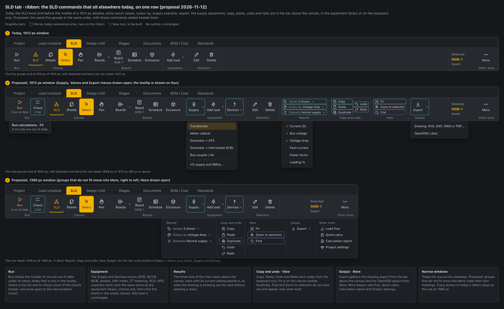

# UI UX proposal – SLD ribbon (2026-11-12)

Status: **proposal, awaiting approval**. Nothing in `src/` changes until approved.

Mockup: `docs/mockups/sld-ribbon-mockup.html` (image: `sld-ribbon-mockup.png`).

## Today

The SLD tab shows Run, Canvas, Boards, Equipment and Selection, then the Selected box and More (`src/components/Ribbon.tsx`, the `[run, canvas, boards, equipment, selection]` tools). On a 1912 px window the five groups end at about 835 px, so the right half of the row is empty. The SLD commands that are not on the row:

- Result values, Colour by, Supply scenario and `Export…` are in the bar above the canvas (`DiagramResultsBar`, `App.tsx`).
- Transformer, meter cabinet, generator, bus coupler, protection, metering and capacitor bank are only in the equipment library (`PALETTE` in `src/model/sldEdit.ts`).
- Undo, Redo, Copy and Paste have no button: keyboard or the command palette only.
- The fail and to-check counts are chips in the results drawer. The out-of-date count is only in Run's tooltip.
- More holds five unrelated items.
- On a narrow window the row scrolls sideways, and the tooltips are the plain system ones.

## Proposed

The five groups keep their order and every button they have. Rule: a button is either a command that works today or it is marked new and appears only when its tool is built.

| Group | On the ribbon | Where it is today |
|---|---|---|
| Run | Run with "3 out of date" under it; **Check** with "2 fail", one press goes to the next problem circuit | Tooltip; chips in the results drawer |
| Canvas | SLD, Sheets, Select, Pan | Unchanged |
| Boards | Boards, Board, Schedule, Enclosure | Unchanged |
| Equipment | **Supply** menu: Transformer, Meter cabinet, Generator + ATS, Generator + interlocked ACBs, Bus coupler / tie, HV supply and RMUs… · Add load (unchanged) · **Devices** menu: protection, metering, capacitor bank | Equipment library (same items: choose, then click the board or canvas); Panels → Transformers for the HV card |
| Selection | Edit, Delete | Unchanged |
| Results | Three rows, each with its current setting: Values, Colour by, Scenario | The `View (n)` menu in the bar above the canvas |
| Copy and undo | Copy, Paste, Undo, Redo · Duplicate (**new tool**) | Keyboard only |
| View | Fit · Zoom to selection, Find (**new tools**) | Fit is on the canvas toolbar |
| Output | Export menu: the drawing (SVG, DXF, DWG, PDF) and OpenDSS | Bar above the canvas; More |
| More | Load flow, Quick calcs, Calculation report, Project settings | Five items, two move to Export |

Also proposed:

- Tooltips that show the shortcut key, using the tooltip Design CAD already has (`.ribbon-tip`).
- Narrow windows: groups that do not fit move into More under their own headings, right to left, instead of the row scrolling.

Widths, measured on the mockup with the app's button sizes:

| Row | Needs | Window |
|---|---|---|
| Today | 1031 px | 1912 px |
| Proposed | 1846 px (66 px to spare) | 1912 px |
| Proposed, narrow | 1258 px, with Results, Copy and undo, View and Output in More | 1366 px |

Design CAD folds each group to its own button. That does not fit here: four folded buttons need about 290 px more, which would push Selection and Equipment off the row at 1366 px. One More menu keeps every button of today's ribbon on the row.

## What stays the same

- Group order, and every existing button, name, icon and shortcut.
- The Selected box.
- The canvas toolbar: zoom, grid, symbol style, full screen.
- The diagram tabs (System, Board, Earthing, Riser) and the calculation chip in the bar above the canvas.
- Every other ribbon tab. The Load schedule tab shares Run and Add load with this tab and keeps today's set.

## Suggested steps

1. Existing commands onto the row: Run count, Check, Supply, Devices, Results, Copy, Paste, Undo, Redo, Export, and the More overflow for narrow windows.
2. Tooltips with shortcut keys.
3. New tools, each with its button: Duplicate, Find, Zoom to selection. The View group appears with them.

## For the user to decide

1. After the move, do the `View (n)` lists and `Export…` leave the bar above the canvas, or stay in both places? Suggested: ribbon only.
2. Results as three small rows with the setting beside each (as drawn), or three large buttons? Large buttons need about 80 px more, so another group would have to give way.
3. Narrow windows: move groups into More (as drawn), or split the SLD tab into two sub-tabs?
4. Which new tools to build: Duplicate, Find, Zoom to selection.
5. Calculation report: stay in More (as drawn), or a Report button beside Export? With it the row has 8 px to spare at 1912 px.
6. Is "Copy and undo" the right name for that group?
