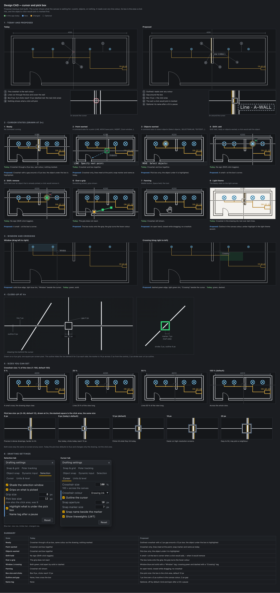

# UI UX proposal – Design CAD cursor and pick box (2026-11-13)

Status: **proposal, nothing built.** Waiting for the user's answers to the questions at the end.

Mockup: `docs/mockups/cad-cursor-pickbox-mockup.html` (image: `cad-cursor-pickbox-mockup.png`).

## Today

The cursor is drawn on the canvas overlay by `drawCursor` (`src/components/cad/CadCanvas.tsx`); the system pointer is hidden (`.cad-over{cursor:none}`).

- **One shape for everything.** A crosshair and a pick box are drawn whatever the canvas is waiting for: the box shows while LINE asks for the next point, and the crosshair shows while a command asks to select objects.
- **Same colour as the drawing.** The crosshair and box use `--cad-cross`, which is `--canvas-ink`: the colour of every line drawn in the default colour. Over walls and cables it disappears.
- **Lines through the box.** The crosshair runs through the middle of the pick box and covers the object about to be clicked.
- **The box size is not the click size.** The box is drawn `pickPx` wide (default 9 px), but clicks hit within a fixed 6 px of the centre (`6 * pixel`, 26 places in `CadPage.tsx`), a 12 px area. Changing "Pick box size" in Drafting settings changes the drawing only.
- **No hint before the click.** Nothing marks the object under the box, so in a dense plan the user clicks, looks, and clicks again.
- **Grips do not react** when the cursor is over them.
- **Window and crossing** are both green, told apart by the dash only.
- **Panning** (middle button, Space, Pan tool) still shows the crosshair.

## Proposed

The cursor shows what the canvas is waiting for. Strip 2 of the mockup draws each state.

| State | When | Cursor |
|---|---|---|
| Ready | No command running | Crosshair with a gap around the pick box; the object under the box is highlighted |
| Point wanted | A command asks for a point (LINE, MOVE base point, INSERT, Zoom window…) | Crosshair only, lines meet at the point; snap marker and name as today |
| Objects wanted | A command asks to select objects (Select objects:, SELECTSIMILAR, TEXTEDIT…) | Pick box only; the object under it is highlighted |
| Shift held | Ready or Objects wanted | A small **+** at the box's corner when a click would add the object, **−** when it would remove it (Shift-click toggles today) |
| Over a grip | Something picked, grips shown | The box locks onto the grip; the grip turns the hover colour (`--warn`) |
| Window / crossing | Dragging from empty space | Window (left to right): solid edge, blue tint, "Window" beside the cursor. Crossing (right to left): dashed edge, green tint, "Crossing" |
| Panning | Middle button, Space held, Pan tool | An open hand, closed while dragging; no crosshair |

Drawing rules for every state:

- **Outline.** Crosshair, box and snap markers are 1 px lines drawn over a 3 px outline in the canvas background colour, so they read over lines of any colour, on dark and light themes.
- **Gap.** The crosshair stops 2 px outside the pick box.
- **The box is the click area.** One pick size, `pickPx`, for the box and for every click (replaces `6 * pixel`). The default goes from 9 to 12 px, so clicks hit what they hit today and the box is 3 px larger.
- **Hover highlight.** The object a click would pick (the same nearest-within-the-box rule) is drawn 2 px wider over an amber outline (`--acc` at 40 %). Devices: their symbol outline. Selected objects stay green as today, so hover and selection never look alike.
- **Name tag after a pause (optional).** When the cursor rests 0.5 s on an object: a tag with its kind and layer, for example "Line · E-LIGHTING", or for a device its name and kind, "DB-GF-01 · Board".

Strip 4 is a close-up at 4× with the sizes: line 1 px, outline 3 px, box 12 px, gap 2 px, marker 7 px.

### Sizes

Strip 5 shows the two sizes side by side. Both stay the same on screen at any zoom.

- **Crosshair size:** 1–100 % of the view (as today), shown at 5, 25, 50 and 100 % (default). Below 100 % the gap around the box stays.
- **Pick box size:** 3–30 px, shown at 6, 9 (today's default), 12 (proposed default), 16 and 20 px. The click area is the box at every size.

### Drafting settings

Strip 6 shows the two tabs with the new rows marked.

- **Cursor:** Crosshair size (as today) · **Crosshair colour** (new: Drawing ink, Accent, Cyan; default Drawing ink) · **Outline the cursor** (new, on) · Snap aperture, Snap marker size, Snap name beside the marker, Show lineweights (as today).
- **Selection:** Shade the selection window, Grips on what is picked, Grip size (as today) · Pick box size (now also the click area, default 12 px) · **Highlight what is under the pick box** (new, on) · **Name tag after a pause** (new, off).

Reset on each tab restores the new defaults. Old saved settings keep their pick box size; a saved 9 px means clicks get a little tighter for that user (see question 2).

## How it would be built

- `CadPage` passes a cursor state to `CadCanvas` from the tool and its step: a pure `cursorModeOf(tool, step)` with a unit test per tool family. `drawCursor` draws from that state.
- Pick size: one helper `pickTol(pixel)` from `draft.pickPx / 2` replaces the `6 * pixel` uses; a regression test that a click at 6 px still hits at the default.
- Hover: at most one hit test per frame, only after the cursor moves; sketch objects use `hitAt` (JS), drawing entities use `view.pick` after the cursor rests about 40 ms, so moving fast costs nothing. Checked with `npm run bench`.
- Colours are existing tokens (`--canvas-ink`, `--canvas-bg`, `--acc`, `--ok`, `--warn`, `--res-cur`); no new theme colours. PDF and DXF output are not affected.

Suggested steps, one PR each:

1. Cursor states, outline, gap, pick box = click area.
2. Hover highlight and grip hover.
3. Shift badge, window and crossing colours and labels, pan hand.
4. The Drafting settings rows, and the name tag.

## Questions

1. Are the cursor states right: no pick box while a point is asked for, and no crosshair while objects are asked for?
2. Pick box default: **12 px** (clicks hit what they hit today, box 3 px larger; suggested) or keep **9 px** (box unchanged, clicks a little tighter)?
3. Hover highlight in amber (suggested), or green dashed like the selection?
4. The name tag after a pause: off by default (suggested), on, or not at all?
5. Crosshair colour choices: Drawing ink, Accent and Cyan, or other choices?
6. Window blue and crossing green with their labels, or keep both green?
7. Which step first? Step 1 is suggested: it also fixes the box size that does not match the click.
