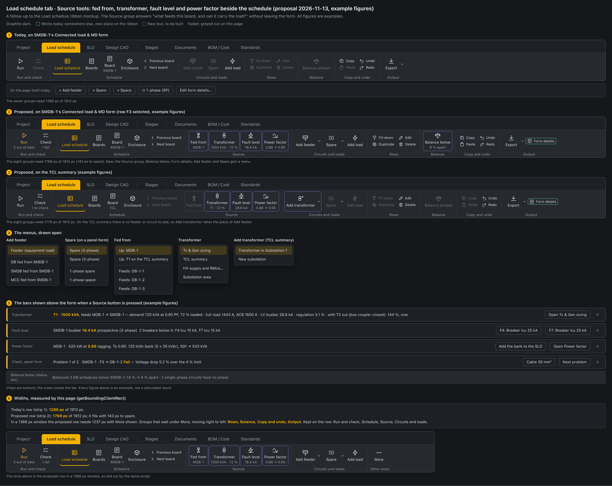

# UI UX proposal – Load schedule tools for MDB, SMDB and transformers (2026-11-13)

Status: **proposed, waiting for the user's decision.** Nothing is built.

Mockup: `docs/mockups/load-schedule-source-tools-mockup.html` (image: `load-schedule-source-tools-mockup.png`). Figures in it are examples.

Follows [UI UX proposals - 2026-11-12 - Load schedule ribbon](UI%20UX%20proposals%20-%202026-11-12%20-%20Load%20schedule%20ribbon.md), whose step 1 and four tools shipped in v2.109.

## Today

The user sent a picture of the Load schedule tab on 2026-11-13 and asked for tools for the MDB, SMDB and the source (transformer).

The ribbon's tools work on a DB's load distribution schedule only. On the other forms of the page (`LoadScheduleView.tsx`):

- **Connected load & MD form** (MDB, SMDB, MCC, meter cabinet): Check, Add circuit, Spare, Fill down, Duplicate, Edit, Delete, Balance phases, Copy and Paste are greyed. Undo, Redo, Add load and Export work.
- **TCL summary** and **Busbar riser**: the same buttons are greyed.
- The commands these forms have are on the page:
  - MD form (`MdSheetView.tsx`): Add feeder, Spare, Space, a 1-phase (SP) tick, Edit form details…, and a bin on each row.
  - TCL summary (`TxSummaryView.tsx`): + Transformer on each substation line, + Substation, Edit form details…, × on each row, and double-click to edit.
  - Busbar riser: the Edit the riser link.
- The MD form's grid already has the Excel keys: copy, paste and fill down (`ClassicGrid` uses `useExcelGrid`). Only the ribbon buttons are not connected to it.
- The tab does not show how loaded the transformer is, the fault level at a panel or its power factor. The app calculates all three on other pages:
  - transformer loading, full-load current, ACB, fault, regulation and the bus coupler case: `sizeTransformers` and `transformerChecks` (`src/calc/txGen.ts`, Tx & Gen sizing page);
  - fault and loading at each busbar: `boardSummary` (`src/calc/summary.ts`);
  - kVAr to the target power factor per board: `planPfc` (`src/calc/pfc.ts`, Power factor page);
  - phase balance of a board with everything below it: `phaseBalance` (`src/calc/phaseBalance.ts`).

## Proposed

### Part 1 – the same buttons work on every form

These are existing commands. Nothing new is calculated.

| Button | DB schedule (today) | MDB / SMDB / MCC form | TCL summary |
|---|---|---|---|
| Check | Next failing circuit | Next outgoing feeder that fails or needs checking, with the SLD's reasons and quick fixes (`failReasons`, `quickFixes`). Then the panel itself: loading against its rating, and breakers whose Icu is below the busbar fault | Next transformer that is over 100 % loaded, has a busbar or ACB below its duty, or fails with the bus coupler closed (`TxChecks`, `outage`) |
| Add circuit | Circuit, 3-phase circuit | Reads **Add feeder**: Feeder (equipment load, as the page's Add feeder) · DB, SMDB or MCC fed from this panel (the Boards menu) | Reads **Add transformer**: Transformer in the selected row's substation · New substation |
| Spare | Spare, Space, 3-phase spare, 3-phase space | Spare, Space (3-phase) · 1-phase spare, 1-phase space. This replaces the 1-phase (SP) tick | Greyed |
| Fill down, Copy, Paste | The grid | The MD form's white cells | Greyed |
| Edit | The circuit dialog | The selected feeder's cable and breaker, the same dialog as Edit on the SLD tab | The transformer row dialog (as double-click) |
| Delete | The circuit | The selected feeder. A feeder that supplies a panel cannot be deleted here, as now | The transformer, after asking, as the × on the row |
| Duplicate | The circuit | An equipment feeder. Greyed on a feeder to a panel, with the tooltip "Copy the board on the SLD tab" | Greyed |
| Form details | – | Small button in Output: Edit form details… | The same |

On the Busbar riser, Edit opens Calculate → Busbar riser, the same as the page's link.

### Part 2 – a Source group (new tools)

A new group, **Source**, placed after Schedule. It works on every form, for the panel on screen. On the TCL summary it works for the selected transformer row.

| Button | Under the button | Press | Arrow menu |
|---|---|---|---|
| **Fed from** | The panel above, for example "MDB-1" | Opens that panel's Connected load & MD form. From a main board, it opens the TCL summary with its transformer marked | Up the chain (MDB-1, T1 on the TCL summary) · the panels this one feeds |
| **Transformer** | kVA and loading, for example "1000 kVA · 72 %" ("no kVA" when not set) | A bar above the form: demand kVA and PF, loading, full-load current, ACB, LV busbar fault, regulation, and the case with the other transformer out when there is a bus coupler. Open Tx & Gen sizing | Tx & Gen sizing · TCL summary · HV supply and RMUs… · Substation area |
| **Fault level** | 3-phase prospective fault at this busbar, for example "18.4 kA", marked when a breaker is below it | A bar: the busbar fault and each breaker on this panel whose Icu is below it, each with the SLD's fix (for example "F4: Breaker Icu 25 kA") | – |
| **Power factor** | This panel's PF and the target, for example "0.88 → 0.95" | A bar: kW, PF, the bank to reach the target and the kVA before and after. Add the bank to the SLD (`addPfcBanks`) · Open Power factor | – |

The bars use the style of the Check bar from v2.109 (above the grid, in the missing-WATT warning style).

### Part 3 – Balance below

On the MD form, **Balance phases** reads **Balance below**. Under it: how far apart this panel's phases are, with everything below it (`phaseBalance`), for example "8 % apart".

Press: each DB schedule fed from this panel is balanced with the DB's own Balance phases, as one undo step. The status bar gives the result, for example "Balanced 3 DB schedules below SMDB-1: 14 % → 4 % apart · 2 single-phase circuits have no phase".

It does not move the panel's own single-phase feeders between phases (decision 4).

## Widths

Measured on the mockup with the app's button sizes. The manual's 1600 px capture of the real app gives about 1340 px for today's row, so the real figures may be about 50 px wider.

| Row | Needs | Window |
|---|---|---|
| Today | 1286 px | 1912 px |
| Proposed, MD form | 1769 px (143 px to spare) | 1912 px |
| Proposed, TCL summary | 1776 px | 1912 px |
| Proposed, narrow | 1237 px, with Rows, Balance, Copy and undo and Output under More | 1366 px |

## What stays the same

- The DB load schedule form: every button, its tooltips and its behaviour.
- Every form's content and every exported form. Exports stay black-and-white.
- The SLD tab and every other ribbon tab.
- On the TCL summary, the + Transformer on each substation line. It says where the transformer goes.

## Suggested steps

1. Part 1: existing commands on the MD form and the TCL summary. It needs no new calculation.
2. Fed from and Transformer.
3. Check on the MD form and the TCL summary.
4. Fault level and Power factor.
5. Balance below.

Each step is one PR with tests. Each new tool is added only on the user's word.

## Decisions

1. Group name: **Source** (suggested) or Supply? The SLD tab already has a Supply button that adds a transformer.
2. Should Add circuit change its caption with the form ("Add feeder", "Add transformer")? Suggested: **yes**. The other option is one caption, "Add", on every form.
3. Do the page's Add feeder, Spare, Space, 1-phase tick, + Substation and Edit form details… leave the page? Suggested: **ribbon only**, as chosen for the DB form, except + Transformer on each substation line.
4. Balance below: should it balance only the DB schedules below, or also move the panel's own single-phase feeders between R, Y and B? Suggested: **DB schedules only** first. Moving a panel feeder changes the SLD and the MD form, so it needs a preview first.
5. Which steps to build, and in which order? Suggested: **the order above**.
