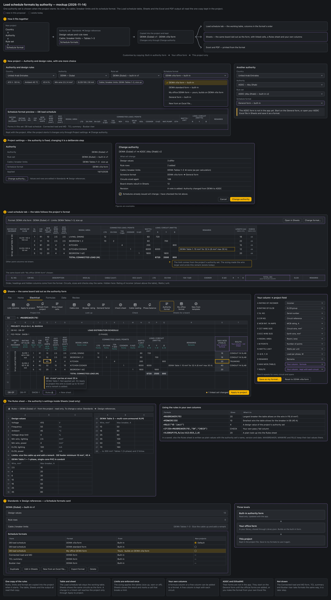

# UI UX proposal – Load schedule formats by authority (2026-11-14)

Status: **proposal, awaiting a decision.** Nothing here is built.

Mockup: `docs/mockups/load-schedule-authority-formats-mockup.html` (image: `load-schedule-authority-formats-mockup.png`). Figures in it are examples.

Follows [UI UX proposals - 2026-11-13 - Sheets (built-in Excel editing)](UI%20UX%20proposals%20-%202026-11-13%20-%20Sheets%20(built-in%20Excel%20editing).md) (stages 4 and 5: link columns, Electrical tab) and the authority rule sets built in v1.83 and v2.097.

## The question

The owner asked on 2026-11-14: the app has the Load schedule tab and the built-in Sheets page. How can the load schedule format of each authority be mapped through both, where is it set up (the authority is chosen before the project starts and does not change at random), how do the authority's rules (the DEWA cable / breaker limits) come into the Excel tables, and how does a user customise it?

## Today

- **Project start** asks Country → Authority → Rule set (`AuthorityPicker`, `src/components/BriefEditor.tsx`). The chosen set is copied into the project with its version (`Project.designReference`).
- **An authority set** (`DesignReference`, Standards → Design references) holds 13 design values, rule rows and the cable / breaker limits (`CableLimitSet`: DEWA Tables 1–3, size up / warn / off). A user duplicates a built-in set and edits the copy.
- **Changing it later** is one button (Apply to this project…). Nothing asks twice and nothing lists what will change.
- **The schedule format is not part of the authority set.** All four forms of the Load schedule tab (DB schedule, Connected load & MD, TCL summary, Busbar riser) are drawn to the DEWA layout. The only choice is the point-column template (DEWA villa or DEWA standard) in Project settings. An ADDC or EtihadWE project gets the DEWA layout and the word "DEWA" on its forms (`mdSheet.ts`, `txSummary.ts`, `formWorkbook.ts`).
- **Your own Excel format** exists for export only: an .xlsx with `{{placeholders}}` (`src/docs/xlsxTemplate.ts`). It is kept per computer, one file, not with the authority or the project.
- **Sheets** has the grid, formulas, File and Home tabs, and opens and saves .xlsx. It has no link to the project yet; its Electrical tab is greyed. It does not keep merged cells, borders or colours of an opened file.

## Proposed

### 1. The schedule format becomes the fourth part of the authority set

An authority set holds: design values, rule rows, cable / breaker limits, and now **schedule formats**. A format is one form laid out as a sheet, with each column linked to a project field:

- the heading block (project, DB no., fed from, location) and the heading rows;
- the columns in order, each linked to a field (MCB rating, wire, room, points, load per phase, remarks…), or marked as *your own column*;
- which row repeats for every circuit and spare, and the total rows;
- the Excel file it came from, kept whole, so the Excel output keeps its merges, borders and logo (this is how the template export already works).

Built in: **DEWA villa form** and **DEWA standard form** (today's two point templates with today's columns), and a **General form** with no authority wording.

### 2. Chosen when the project starts, then fixed

- New project → Country → Authority → Rule set → **Schedule format**, with a preview of the column headings.
- The format is copied into the project with the rules and limits. Updating the library later does not change a running project.
- Project settings shows the authority, rule set, limits and format as read-only lines with one button, **Change authority…**. It lists what will change (values, rule rows, limits, format, circuits to be sized again, board sheets to be rebuilt), asks for a tick, and adds a revision note.

### 3. The Load schedule table follows the format

- Column order, headings and hidden columns come from the project's format. The table-only columns (Length, Check) stay at the end.
- Circuits, sizing, checks and remarks do not change. The limit remark ("DEWA Table 1: 10 mm² for 32 A (6 mm² max 30 A)") is written by the sizing, as today.
- A line above the grid names the format, the authority set and the limits, with **Open in Sheets**.
- Authority wording on the forms comes from the project's set, so an ADDC project no longer prints "DEWA".

### 4. Sheets shows the same board as the authority form

- Electrical → Sheets for a board → **Authority format** (or **My office format**) makes a sheet for the board from the project's format: the form as laid out, filled from the project.
- **Link columns** panel: "Your column → project field" with a pick list. No typed placeholders; a file that already has `{{placeholders}}` is read as links.
- A change in a linked cell is marked and reaches the project only through **Apply to project**. **Refresh from project** brings the sheet up to date.
- Columns can be moved, renamed or hidden, and the result saved with **Save as my format…**.

### 5. The authority's rules inside Sheets

The rules stay in one place: the copy in the project. Sheets shows them three ways.

1. **Rules sheet** (read only) in the board's workbook: the design values, the rule rows and the cable / breaker tables of the project's set. Values are changed in Standards → Design references, not here.
2. **Functions** for your own columns:
   - `MAXBREAKER(wire)` — largest breaker the table allows on that wire;
   - `MINWIRE(breaker)` — smallest wire the table allows for that breaker;
   - `RULE("VD limit")` — a design value.
   - A plain `VLOOKUP` into the Rules sheet also works.
3. **Marks**: a linked cell that breaks a limit is marked with the reason ("4 mm² carries at most 20 A — DEWA Table 1"). On Apply to project the sizing does what the set's mode says: size up and remark, warn, or nothing.

In a saved .xlsx the Rules sheet is plain values with the set's name, version and date; the three functions keep their last values.

### 6. Customising

Three levels, each a copy of the one above it (the same pattern as rule sets):

| Level | Where | Who changes it |
|---|---|---|
| Built-in authority form | In the app, read only | Updated with the app |
| Your office form | Your library, shared through `Library.json` | You: duplicate, edit in Sheets, or New from an Excel file… |
| This project | In the project file | You: a change for one project; Save to my formats to keep it |

Typical uses:

- **Villa and building forms** under one authority: pick the form at project start.
- **Office format**: own heading block, column order and headings; the authority's fields stay linked.
- **Own columns**: a formula column (total per circuit, max breaker from the table, a pass / fail) or a free column (cable route, contractor's note) kept with each circuit.
- **An authority the app does not have**: open its Excel form in Sheets, link the columns, save it as a format under your copy of the nearest rule set.

Standards → Design references gets a **Schedule formats** card under Cable / breaker limits: the list of formats per form, the default for new projects, Duplicate, Edit in Sheets, New from an Excel file…, Export format.

### 7. ADDC and EtihadWE

Their official forms are not in the app, and they are not invented here. Until they are added, these authorities start on the General form. The forms and the full regulations are still needed from the owner (open since 2026-10-27).

## What stays the same

- The Load schedule tab stays the working table. Sheets is the form view and the place to design a format.
- The calculation and the limits are applied by the engines only. No formula in a sheet changes a size.
- A DEWA project's table, Excel and PDF output stay as they are today (checked by the existing regression and PDF baselines).
- PDF output stays black-and-white.

## Steps (one PR each)

1. **Format model**: schedule formats on the authority set and on the project; DEWA villa, DEWA standard and General built in; point templates become formats; authority wording from the set. No screen change; DEWA output unchanged.
2. **Project start and Project settings**: the fourth choice with its preview; the read-only lines and Change authority… with its list.
3. **Load schedule table follows the format**: order, headings, hidden columns, the line above the grid.
4. **Sheets keeps merged cells and borders** (its Merge cells button is not connected today). Needed before a form looks right in Sheets.
5. **Sheets link**: Link columns panel, Authority format / My office format for a board, Apply to project, Refresh from project.
6. **Rules in Sheets**: Rules sheet, `MAXBREAKER` / `MINWIRE` / `RULE`, marks, Check sheet.
7. **Schedule formats card** in Design references; your own Excel template moves from the per-computer setting into the formats (old files keep working); `lvds schedule-xlsx --format`.
8. **Own free columns** kept with each circuit; formats for the Connected load & MD form, TCL summary and Busbar riser.
9. **ADDC and EtihadWE forms**, when the official forms arrive.

Steps 1–3 work without Sheets. Steps 4–6 are the Sheets stages 4 and 5 of the earlier proposal, in this order.

## Decisions needed

1. **One definition or two?** Suggested: one. The form sheet with its links is the format, and the table takes its column order, headings and hidden columns from it.
2. **Changing the authority after the project starts.** Suggested: allowed, but only through Change authority… with the list and the tick. Other choices: locked after the first issued revision; or as today (one button).
3. **ADDC and EtihadWE until their forms arrive.** Suggested: the General form. Other choice: keep the DEWA layout with the authority's name.
4. **One format per project, or per board too?** Suggested: per project now; a different form for one board (a plant-room panel in a villa project) later.
5. **Rules in Sheets.** Suggested: all three (Rules sheet, functions, marks). Other choice: marks only.
6. **Own free columns kept with each circuit.** It needs a small addition to the circuit data. Suggested: yes, in step 8.
7. **Order.** Suggested: steps 1–3 first (the table), then Sheets.

Also needed: the ADDC and EtihadWE load schedule forms, and two or three office Excel schedules to test the links with.

## Not in this proposal

- Submission sets (which documents each application stage needs).
- Rule sets for other countries.
- Charts, pivot tables, macros and conditional formatting in Sheets (left to Excel, as agreed on 2026-11-13).
