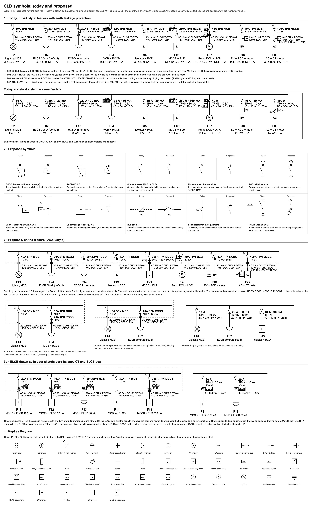

# UI UX proposal – SLD symbols: the list, and the earth leakage devices (2026-11-16)

Status: **proposal, waiting for the user's decisions.** Nothing is built.

Mockup: `docs/mockups/sld-symbols-mockup.html` (image: `sld-symbols-mockup.png`).

The user's request: list the SLD symbols in use and say which can be enhanced. They do not like the ELCB symbol: fitted into the breaker it overlaps, and the drawing does not look like a standard design drawing.

## The symbols today

The SLD draws from one library, `src/diagram/symbolLibrary.tsx`: 55 IEC 60617 symbols on one frame (the RMU in open PR 617 makes 56). `src/diagram/IecSymbols.tsx` picks them for feeders, loads and the legend. Switching devices are drawn at half size (`SYM_SCALE.device` 0.5), in a 16-unit slot 18 units below the busbar.

| Group | Symbols | Drawn on the SLD today |
|---|---|---|
| Switching and protection (13) | cb, acb, nonauto, isolator, swdisc, contactor, fuse, fusesw, rcbo, rccb, rcd, shunt, ats | all but swdisc, contactor, fuse, fusesw, shunt |
| Panels (6) | p-mdb, p-smdb, p-db, p-edb, p-mcc, p-apfc | all (boards drawn as one box, risers) |
| Starters and relays (8) | dol, sd, ss, vfd, ol, uvr, pmr, pfrelay | all but ol, pmr |
| Sources (4) | tx, gen, incomer, pv | all but incomer |
| Metering and interfaces (13) | ct, vt, voltmeter, ammeter, kwh, pmu, bms, faim, elr, lamp, spd, earth, pe | all but vt, bms, faim, elr, earth, pe |
| Loads and distribution (11) | busbar, motor, motor-fp, lighting, socket, capacitor, eq-ac, eq-ev, eq-it, eq-l, existing | all but busbar, existing (the legend draws lines) |

Drawn by hand outside the library: the RCCB, ELCB, ELR and starter label boxes beside a feeder, the local isolator (a slanted line and a dot), the bus coupler (a box with a slash), the incomer relay CT ring, the electro-mechanical interlock, the OC / SC / EF trip boxes, the earth pit, and the UPS and RMU boxes. The Board tab (`SingleLineDiagram`) and the printed board sheet (`boardSheet.ts`) draw their own transformer circles, and the board sheet its own breaker (`switchSym`). Neither shows an RCBO or RCCB symbol, only "30 mA RCD" text.

## What is wrong today

Found by drawing one board with every earth leakage case through the app's own System diagram code (mockup section 1):

1. **RCBO in the breaker slot** (a feeder with an RCD rating, or "ELCB" / "RCBO" in its remarks). The toroid and the dashed trip link hang outside the symbol's body. The toroid sits on the cable just above the DEWA panel frame line. The link runs at x + 7, into the rating text that starts at x + 10 ("10 kA · 30mA ELCB", "20 A · 30 mA").
2. **The text does not match the symbol.** DEWA style prints "20A SPN MCB" and "10 kA · 30mA ELCB" (two devices) beside one RCBO symbol. An isolator with an RCD is drawn as an RCCB but labelled "40A TPN MCB": `deviceKind` ignores `device: 'ISOL'`.
3. **An RCCB after a breaker ("RCCB" in the remarks) and an ELR** are words in a box, joined to the power line by a solid line, so they read as branch circuits. A loose toroid sits on the cable, on the frame line. In DEWA style the box runs into the text of the column on its left. The library's own `elr` symbol is never used, and nothing shows the ELR tripping the breaker.
4. **The RCCB symbol** draws only the disconnector bar, though its label says switch-disconnector (07-13-08).
5. **Size.** At half size the breaker's × is 4 units across and the toroid 6 × 3, smaller than the 11 px text beside them.
6. **Placements:** the UVR box touches the breaker blade; with a UVR, the DOL box crosses the DEWA panel frame line; kWh and CT meter boxes cover the cable text in DEWA style; the local isolator is not the library isolator.
7. **The non-automatic breaker (MCCB NA)** carries the ×, the sign of automatic tripping, though it cannot trip.
8. **The ACB draw-out marks** are single chevrons, hard to see at drawing size.

## Proposed

Mockup sections 2 and 3.

1. **One switching frame.** Every switching symbol pivots its blade at y 48 instead of 56, so all breakers share an 8-unit foot. An RCD's toroid sits in that foot, round the line. Its dashed trip link runs on the blade side (left), up to the blade. No part of the device leaves its slot or reaches the text side.
2. **RCBO** = breaker (×) + toroid. **RCCB / ELCB** = switch-disconnector (bar and circle) + toroid.
3. **RCCB after an MCB** = two devices in series, each with its own rating line ("32A TPN MCB / 10 kA", then "40A TPN RCCB / 30mA"). A board with such a feeder gets one more device row (24 units), so its columns stay aligned. The RCCB's rating is the next size in `STANDARD_ELCB_A` (25, 40, 63, 80, 100, 125 A) at or above the breaker, unless one is given.
4. **ELR** = CBCT toroid on the cable below the breaker, the ELR relay box on its left with dashed wiring, and a dashed trip link up to the breaker. The rating goes in the device text: "36 kA · ELR 300mA".
5. **UVR** = an undervoltage release box with a dashed link to the breaker's blade, not wired to the power line.
6. **The text names the device that is drawn**: RCBO, RCCB, MCCB, ISOLATOR. An RCBO's line no longer says "ELCB".
7. **Size (decision 1):** switching devices 1.5 times larger (scale 0.75), in a 24-unit slot that starts 8 units higher; the line above today's breaker is 18 units and mostly empty. Every text row stays where it is. The DEWA way number moves to x − 12, clear of the bigger blade. Incomers, spares and changeover incomers take the same size.
8. **Non-automatic breaker (decision 3):** drawn as a switch-disconnector, without the ×; the text stays "MCCB (NA)".
9. **ACB:** double draw-out chevrons at both terminals.
10. **Bus coupler:** a breaker drawn across the busbar, N/O or N/C below, instead of a box with a slash.
11. **Local isolator:** the library switch-disconnector at device size, its text as today.
12. **Meters:** at the load end, left of the line (direct meter: solid link; CT meter: ring on the line, dashed link), clear of the cable text and of the next column.
13. **DOL with a UVR:** the starter box stays inside the panel frame, on the app's own starter row (`STARTER_DY`); the UVR sits above it as a release.
14. **Board tab and printed board sheet** draw from the same library, so they show the RCBO and RCCB symbols too and drop their own breaker and transformer drawings.

### ELCB as in the user's drawing (added 2026-11-16, mockup section 3b)

The user then sent part of a drawing they use: on each MCCB feeder the earth leakage protection is a core-balance coil on the line with an "ELCB" box beside it and the sensitivity above the box (100mA, 30mA), on a row of its own next to the breaker; the breaker's text is only "20A TP MCCB". They asked whether we can draw the ELCB like that. Proposed, as the default for earth leakage:

- A feeder with earth leakage (an RCD rating, or ELCB, RCCB, ELR or RCD in its remarks) gets that row under the breaker's text: the core-balance CT on the line, the box with the word (ELCB, or RCCB or ELR from the remarks), the sensitivity above the box. Nothing else joins the box to the power line.
- The core-balance CT follows the user's sketch: a ring core round the cable, and one turn of winding wrapped round its left end, with both ends going to the box. On the same day we tried and set aside, as unclear at drawing size or not what the user meant: short lines and an arc, three rings, humps beside the cable, a single ring, and the IEC coil form of a current transformer.
- The breaker's text drops the mA ("20A TPN MCCB / 25 kA"), so text and drawing agree: an MCCB, then its ELCB.
- Only "RCBO" in the remarks keeps the breaker symbol with its toroid (item 2), because an RCBO is one device.
- A board with any such feeder gets one more row (24 units; 32 in the standard style, whose text rows sit lower), so its columns stay aligned.
- In the user's drawing the busbar (blue) is at the bottom, so the ELCB is on the breaker's outgoing side; on our SLD the busbar is on top, so the row goes under the breaker.

This replaces items 2 (RCCB symbol for an ELCB), 3 (RCCB after an MCB as a second switching device) and 4 (ELR) as the default; they remain the alternative under decision 2. The user's drawing also draws the MCCB as an arc between two small circles, the older BS style; that is not proposed here.

Kept as they are: the other 41 library symbols (mockup section 4) and the RMU of PR 617. The other switching symbols (isolator, contactor, fuse switch, shunt trip, changeover) keep their shapes on the new frame. The DXF blocks and the legend follow, because both are made from the library.

## Decisions for the user

1. **Size:** B, 1.5 times larger (recommended), or A, today's size (mockup section 3, middle).
2. **Earth leakage drawing:** the coil and box under the breaker, as in the user's drawing, for ELCB, RCCB and ELR, with RCBO keeping its symbol (recommended, mockup section 3b); or the IEC device symbols (mockup sections 2 and 3: RCCB symbol, two devices in series, ELR with trip link).
3. **Non-automatic breaker:** switch-disconnector (recommended), or keep the × with the bar.
4. **Order:** step 1 the earth leakage drawing, the device text and the size; step 2 NA, ACB, bus coupler, local isolator, meters and DOL; step 3 the Board tab and the board sheet.

## How this was checked

A temporary test (not committed) rendered `SystemDiagram` for one board with ten feeders (MCB; RCD rating only; "RCBO 30mA"; "RCCB 30mA"; isolator with RCD; "ELR 300mA"; DOL with "UVR"; RCD with direct meter; CT meter with local isolator; capacitor), in both drawing styles, printed black through the PDF check's hidden renderer. The mockup's "today" crops are that output; "proposed" draws the new shapes with the same text classes and positions.
