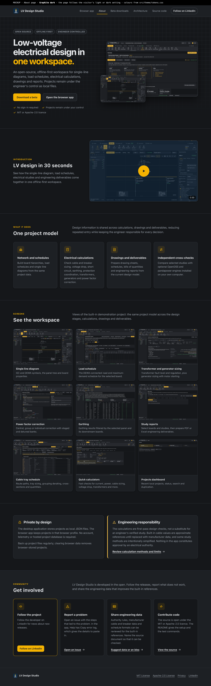
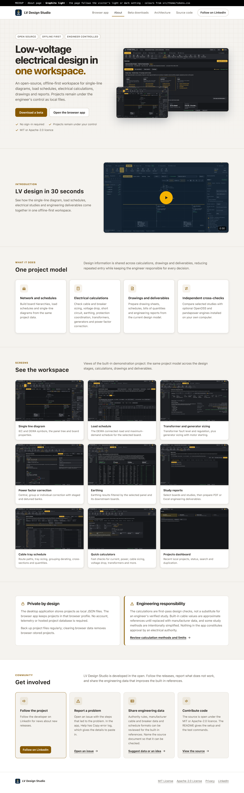

# About page in the Graphite theme, dark and light — proposal (2026-11-20)

Status: **proposed, waiting for approval.** Nothing in this note is built. The Get involved section was approved on 2026-11-20 and is built on its own in the page's present look.

Mockup: `docs/mockups/about-page-graphite-mockup.html`. Opened in a browser it follows the computer's light or dark setting; add `#dark` or `#light` to the address to force one.

## What was asked

"Give a new mockup for our page with a better look, for the dark and light theme, in the Graphite theme from the app."

## Today

- The public About page (`<site>/about/`) and the Beta downloads page share one layout and one style block (`page` and `STYLE` in `scripts/public-site.mjs`). The text comes from `docs/public-site/product.json`.
- The look is the neutral black-and-white one approved on 2026-11-11: white page, black text, square boxes, and no dark version.
- The app itself has used the Graphite colours since v2.032: charcoal and amber in the dark, drafting paper and bronze in the light (`src/theme/tokens.css`). The page and the app do not look like the same product.
- The page runs no script (`script-src 'none'`), loads no outside image or font, and has no form. This proposal keeps all of that.

## Proposal

The page takes the app's Graphite colours, token for token, and follows the visitor's light or dark setting.

| Part | Today | Proposed |
|---|---|---|
| Colours | White and black | Graphite dark (`#15171A`, amber `#F5B301`) or Graphite light (paper `#F5F3EF`, bronze `#875800`), by the visitor's setting |
| Header | Plain links | The same links on a panel bar; the current page has an amber underline; a **Follow on LinkedIn** pill at the right end |
| Top of the page | Headline, text and two buttons | The same on the left, over the drafting grid of the app's drawing surface; two real screenshots on the right (Overview, with the single-line diagram in front) |
| Introduction video | Full width under its heading | Heading on the left, the video beside it |
| One project model | Four boxes, two by two | Four cards in a row, each with a small line icon |
| See the workspace | Ten screenshots, two columns | The other nine in three columns (the Overview is at the top of the page) |
| Private by design, Engineering responsibility | Two text columns | Two cards; the responsibility card has a warning-colour edge |
| Get involved | The approved section, in the page's present look | A band in the panel colour; the LinkedIn card has the accent edge and a filled button |
| Footer | Licence and privacy links | The same, on the panel colour, plus LinkedIn |

Corners are 9 and 12 px, as in the app. The icons are simple line drawings inside the page (no brand logos, no image files).

Text contrast, measured from the tokens: body text 14.6 to 1 in the dark and 13.9 in the light; grey text 7.0 or more in the dark and 6.5 or more in the light; amber on charcoal 9.7; bronze on paper 5.5. All are above the 4.5 to 1 needed for normal text.

The Beta downloads page shares the layout and the style, so it changes with the About page. The Architecture page has its own file (`docs/architecture/navigator.html`) and is not part of this proposal.

## Wording

The wording stays as it is, with one suggested change. The line under "See the workspace" speaks to maintainers today ("These are the committed screenshots used by the project README…"). The mockup shows: "Views of the built-in demonstration project: the same project model across the design stages, calculations, drawings and deliverables."

## How it would be built

- Only `STYLE`, `page` and `renderAbout` / `renderDownload` in `scripts/public-site.mjs` change. The app, its styles and the PDF output are not touched.
- The light colours go in `@media (prefers-color-scheme: light)`. No script is needed, so the page's content rule stays as strict as today.
- The grid at the top is drawn inside the page (an inline pattern). A background picture would be blocked by the page's own rule.
- The mockup's CSS is written to be moved into `STYLE` almost as it is. Its small script is only for the mockup (to force a theme and to size the image).
- Tests: `tests/publicSite.test.ts` and `src/docs/seoMetadata.test.ts` cover the page text and the no-script rule; a test for the two colour sets would be added.

## Decisions

1. **How the theme is chosen.** (a) Follow the visitor's light or dark setting, no switch (recommended: no script, nothing to remember). (b) A switch made with CSS only; it works but is forgotten on the next page. (c) A switch that remembers; this needs a script, which the page does not allow today.
2. **Where the LinkedIn link shows.** (a) Header pill, Get involved card and footer (recommended, as in the mockup). (b) Get involved card only.
3. **The line under "See the workspace".** Take the suggested wording (recommended), or keep today's.
4. **Beta downloads page.** Same look in the same step (recommended), or About first.
5. **Screenshots on the light page.** The committed screenshots are of the dark app, so the light page shows dark screens in light frames. Keep them for now (recommended), or capture a light set later.
