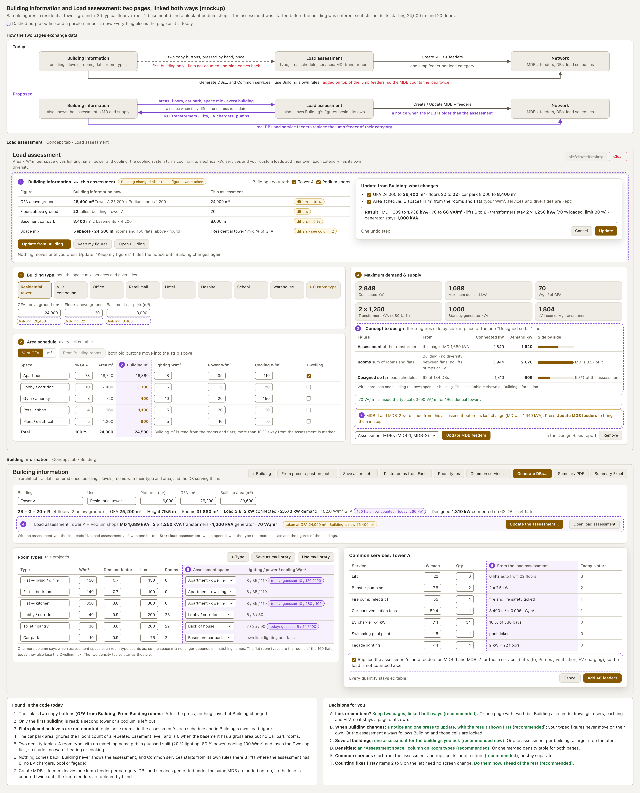

# UI UX proposal – Building information and Load assessment linked both ways (2026-11-21)

Status: **approved 2026-11-21** — the user chose the recommended option for every decision (A–F). Built step by step, starting with step 0 (counting fixes).

Mockup: `docs/mockups/building-load-assessment-link-mockup.html` (image: `building-load-assessment-link-mockup.png`).

## Today

The user's remark: the Building data does not feel linked with the Load assessment. Checked in the code, it is linked only by two copy buttons:

1. **GFA from Building** (`buildingFigures`) and **From Building rooms** (`rowsFromRooms`), both in `src/calc/loadAssessment.ts`, copy once. After the press nothing says that Building changed.
2. Both read `info.buildings[0]`: only the first building. A second tower or a podium is left out.
3. Flats placed on levels (`BuildingLevel.units` × `UnitType.rooms`) are expanded only by `plannedDbs` (Generate DBs). `rowsFromRooms` and `summarizeBuilding` read `info.rooms` only, so the flats are missing from the assessment's area schedule and from Building's own Load figure.
4. Car park area is the rooms typed Car park × their count, without the Floors count of a repeated basement level. It is 0 when the basement has a gross area but no Car park rooms.
5. Two density tables: room types (one W/m² and a demand factor, RoomTypes.xlsx) and assessment spaces (lighting, power and cooling W/m², this computer's library). `rowsFromRooms` pairs them by id or name. A room type with no pair gets a guessed split (20 % lighting, 80 % power, cooling 100 W/m²) and no Dwelling tick, so it adds no water heating or cooking. Of the 16 starting room types, 5 have no pair: Toilet / pantry and the four flat room types.
6. Nothing comes back. Building never shows the assessment, and Common services (`defaultServices` in `src/calc/buildingDesign.ts`) starts from its own rules: 3 lifts above 12 floors where the assessment counts floors ÷ 4, and no EV chargers, pool or façade lighting.
7. Create MDB + feeders (`createMdbFromAssessment`) leaves one lump feeder per load category. Generate DBs and Common services add real DBs and feeders under the same MDB and do not remove the lump feeders, so the MDB counts the load twice until they are deleted by hand.

The two pages also hold two different load figures. Building's is the sum of each room's W/m² × demand factor, with no diversity between flats. The assessment's is the maximum demand at the transformer, with a diversity per category and a coincidence factor. They are not meant to be equal, but today they are never shown side by side.

## Proposed

Keep two pages and link them both ways. The numbers match the mockup.

1. **Link strip on Load assessment**, in place of the two copy buttons. It lists GFA above ground, floors, car park and space mix as "Building information now" against "This assessment", marks what differs, and has tick boxes for the buildings counted. **Update from Building…** shows the result first (MD, VA/m², lifts, transformers, generator) and applies it as one undo step. **Keep my figures** hides the notice until Building changes again. Nothing moves on its own. A small "Building: …" line sits under each of the three typed figures.
2. **Building m² column** in the area schedule: the area of each space read from the rooms and flats, beside the assessment's own. More than 10 % apart is marked.
3. **Concept to design table**, in place of the "Designed so far" line: the assessment (at the transformer), the rooms (sum of room types) and the load schedules designed so far, with connected and demand kW. Rows open per building when there is more than one. The same table on Building information.
4. **Assessment line on Building information**: MD, transformers, generator and VA/m², a mark when the assessment was taken at other figures, and the buttons Update the assessment… and Open load assessment. With no assessment yet: one button, Start load assessment, which opens it with the type matching Use.
5. **Assessment space column on Room types**: which assessment space each room type counts as, so the space mix no longer depends on matching names. Flat room types count as Apartment with the Dwelling tick. The two density tables stay.
6. **Common services start from the assessment**: lift count, EV chargers, pool, façade lighting and car park fans as the assessment has them, every quantity still editable. A tick box replaces the assessment's lump feeders for the same categories, so the load is counted once.
7. **Notice when the MDB is older than the assessment**, beside Update MDB feeders.

Data: `LoadAssessment` gets an optional record of what was taken from Building (buildings counted, GFA, floors, car park), and `RoomType` an optional assessment space. Saved projects stay readable.

## Decisions for the user

- **A.** Link or combine: keep two pages linked both ways (recommended), or one page with two tabs? Building also feeds drawings, risers, earthing and ELV, so it is better as a page of its own.
- **B.** When Building changes: a notice and one press to update, with the result shown first (recommended), or the assessment always follows Building and those cells are locked?
- **C.** Several buildings: one assessment for the buildings ticked (recommended now), or one assessment per building (a larger step, later)?
- **D.** Densities: an Assessment space column on Room types (recommended), or one merged density table for both pages?
- **E.** Common services start from the assessment and replace its lump feeders (recommended), or stay separate?
- **F.** Counting fixes first: items 2 to 5 under Today need no screen change. Do them ahead of the rest (recommended)? They change the figures of From Building rooms, and of Building's Load for projects with flats.

## Build steps (after approval)

0. Counting fixes in `src/calc/loadAssessment.ts` and `src/calc/building.ts` with tests: every building, flats, repeated basements, Dwelling tick for flat rooms. No screen change.
1. Link strip, Building m² column and the assessment line on Building (items 1, 2 and 4).
2. Assessment space column on Room types (item 5), with RoomTypes.xlsx.
3. Concept to design table and the MDB notice (items 3 and 7).
4. Common services from the assessment and the lump feeder replacement (item 6).
