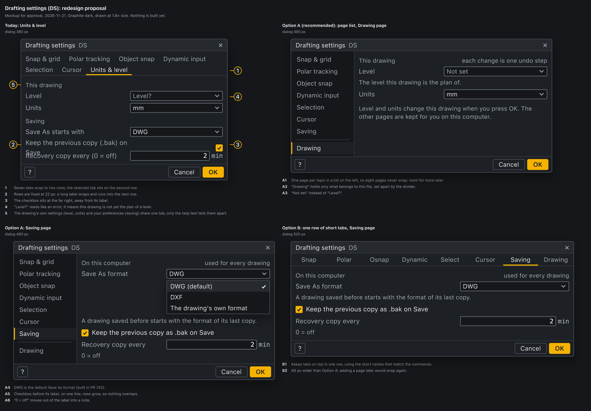

# UI UX proposal – Drafting settings (DS) dialog (2026-11-21)

Status: **proposed**, waiting for the user's decisions A–D. Nothing in the dialog's layout is built yet. The DWG default is built separately in PR 743 (v2.244), with no UI change.

Mockup: `docs/mockups/cad-drafting-settings-redesign-mockup.html` (image: `cad-drafting-settings-redesign-mockup.png`).

## Today

The user sent a picture of Design CAD → Drafting settings (DS) on the Units & level tab (`src/components/cad/CadDraftSettings.tsx`, styles `.cad-dlg*` in `src/styles.css`).

1. **The tabs wrap to two rows.** The dialog is 380 px wide (`.cad-dlg.wide`) and has seven tabs (`.cad-dlg-tabs.wrap`), so Selection, Cursor and Units & level sit on a second row.
2. **A long label runs into the next row.** Rows are fixed at 22 px (`.cad-dlg-r{height:22px}`) on a `1fr 170px` grid. "Keep the previous copy (.bak) on Save" wraps to two lines, and its second line covers "Recovery copy every (0 = off)".
3. **The checkbox is far from its label.** `.cad-dlg-in` aligns the control to the right of the 170 px column.
4. **"Level?" reads like an error.** It means the drawing is not yet the plan of a level (`cadFileMenu`, `level: … 'Level?'`). The box is disabled when there is no level to choose, and it does not say why.
5. **Two kinds of setting share one tab.** Level and units change this drawing (each one undo step on OK). The saving settings are your preferences on this computer. Only the help text says which is which.
6. **Save As started with "The drawing's own" format**, so a drawing received as DXF saved as DXF. PR 743 makes DWG the default, and a choice made before is kept.

## Proposed

Both options keep the Graphite look, the title bar, the ? / Cancel / OK footer, every setting and its behaviour.

**Option A (recommended): a page list on the left.** The dialog is 480 px wide.
- Eight pages in a 116 px list: Snap & grid, Polar tracking, Object snap, Dynamic input, Selection, Cursor, Saving, then a divider and **Drawing**. The selected page has the accent bar on its left edge, like the tab underline turned on its side. Up and Down move between pages.
- Units & level is split in two. **Drawing** holds only Level and Units, under "This drawing — each change is one undo step". **Saving** holds Save As format, the .bak copy and the recovery copy, under "On this computer — used for every drawing".
- Level shows **"Not set"** instead of "Level?", with the note "The level this drawing is the plan of."
- Save As format lists **DWG (default)**, DXF, The drawing's own format, with the note "A drawing saved before starts with the format of its last copy."
- Checkbox rows put the box before its label, on one line: "Keep the previous copy as .bak on Save".
- Rows grow with their text, so nothing overlaps. "(0 = off)" moves out of the label into a note under the box.
- The list has room for more pages later without wrapping.

**Option B: one row of short tabs on top.** The dialog is 520 px wide.
- Tabs: Snap, Polar, Osnap, Dynamic, Select, Cursor, Saving, Drawing, which are the short names CAD users know from the commands.
- The page contents and row fixes are the same as in Option A.
- One more page later would wrap the tabs again.

## Decisions for the user

- **A.** Option A (page list, recommended) or Option B (one row of short tabs)?
- **B.** Split Units & level into Drawing and Saving, as shown? (Recommended: yes.)
- **C.** "Not set" for a drawing that is not the plan of a level? (Recommended: yes.)
- **D.** The wording "Save As format" (was "Save As starts with") and "Keep the previous copy as .bak on Save"? (Recommended: yes.)

## Build, after approval

One PR: `CadDraftSettings.tsx` (page list or tab row, the Drawing and Saving pages), the dialog CSS rules (row height `auto` with a 22 px minimum, a checkbox-first row), and `cadFileMenu` ("Not set"). Tests: the existing DS tests in `CadPage.test.tsx`, `CadStatusToggles.test.tsx` and `cadCommands.test.ts` under `src/components/cad/` (tab names change to page names), plus one test that every page opens and that OK keeps each setting.
