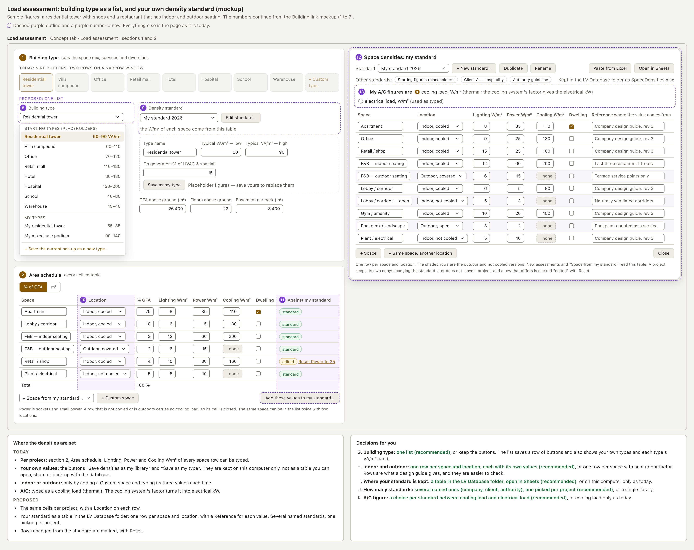

# UI UX proposal – Load assessment: building type list and your own density standard (2026-11-21)

Status: **proposed**, waiting for the user's decisions G–K. Nothing is built. The letters and numbers continue from `UI UX proposals - 2026-11-21 - Building and load assessment link.md` (items 1–7, decisions A–F).

Mockup: `docs/mockups/load-assessment-density-standard-mockup.html` (image: `load-assessment-density-standard-mockup.png`).

## The user's questions

1. Can the Building type buttons become a drop-down list?
2. Where are the densities (lighting, socket and A/C load) set? They are not the same everywhere: the socket load of outdoor seating differs from indoor seating. How can a user keep their own standard values?

## Today

- **Building type** is a grid of nine buttons (`.la-types` in `src/components/docs/LoadAssessmentView.tsx`): eight starting types and "+ Custom type". On a narrow window it wraps to two rows.
- **Per project**, the densities are the cells of section 2, Area schedule: Lighting, Power (sockets and small power) and Cooling W/m² of each space row (`LaRow` in `src/calc/loadAssessment.ts`).
- **Your own values** are kept by the buttons "Save densities as my library" and "Save as my type". They go to this computer only (`lvds.loadAssessmentLibrary`), not to the LV Database folder, so they cannot be opened as a table, shared, or backed up with the database.
- **Indoor or outdoor**: a space has no location. The only way is "+ Custom space" and typing the three values each time.
- **A/C** is typed as a cooling load (thermal W/m²). The cooling system's factor (kW electrical per kW thermal) turns it into electrical kW. A standard that gives the A/C load as electrical W/m² cannot be typed as it is.

## Proposed

8. **Building type as one list.** Groups: starting types, then "My types", each with its VA/m² band, and "+ Save the current set-up as a new type…" at the end.
9. **Density standard** picker beside it, with **Edit standard…**. The W/m² of each space come from the picked standard.
10. **Location column** in the area schedule: Indoor cooled, Indoor not cooled, Outdoor covered, Outdoor open. The same space can be listed twice with two locations (F&B indoor seating and F&B outdoor seating). A row that is not cooled or is outdoors carries no cooling load; its cell is closed.
11. **Against my standard column**: "standard" when the row equals the standard, "edited" with Reset when it was changed in this project. "Add these values to my standard…" writes the project's rows back.
12. **Space densities table**: one row per space and location with Lighting, Power, Cooling, Dwelling and a Reference (where the value comes from). Several named standards (company, client, authority); the starting figures stay as "placeholders". Kept in the LV Database folder as SpaceDensities.xlsx, so it opens in Sheets, can be pasted from Excel, and travels with the database.
13. **A/C figure choice** per standard: cooling load (thermal, as today) or electrical load (used as typed, no cooling-system factor).

A project keeps its own copy, as today: changing a standard later does not move a project.

Data: `LaSpace` gets an optional location; the catalogue gets a space densities table with a standard name per row; `LoadAssessment` records the standard it started from and the A/C basis. The library on this computer becomes the first standard, so nothing typed so far is lost. Item 5 of the Building link proposal (Assessment space on Room types) then picks a row of this table.

## Decisions for the user

- **G.** Building type: one list (recommended), or keep the buttons?
- **H.** Indoor and outdoor: one row per space and location, each with its own values (recommended), or one row per space with an outdoor factor? Rows are what a design guide gives and are easier to check.
- **I.** Where the standard is kept: a table in the LV Database folder, open in Sheets (recommended), or on this computer only as today?
- **J.** How many standards: several named ones, one picked per project (recommended), or a single library?
- **K.** A/C figure: a choice per standard between cooling load and electrical load (recommended), or cooling load only as today?

## Build steps (after approval)

1. Location on a space and the closed cooling cell (item 10), with tests. Engine first.
2. Space densities table in the catalogue, the standard picker and the table dialog (items 9, 11, 12); the library on this computer carried over.
3. Building type list (item 8).
4. A/C figure choice (item 13), with tests.
