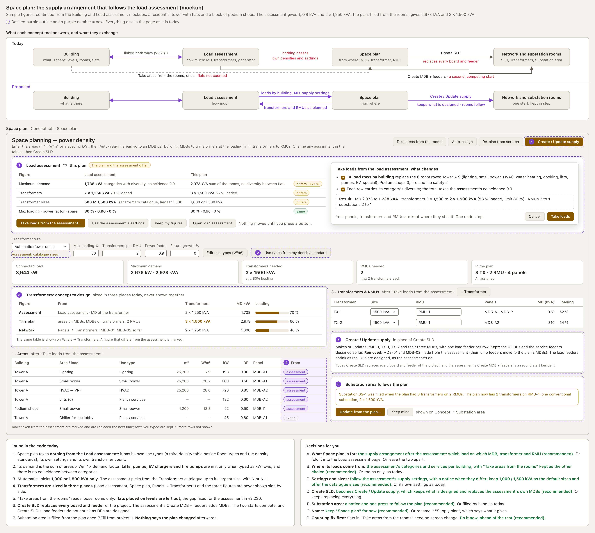

# UI UX proposal – Space plan as the supply arrangement after the load assessment (2026-11-21)

Status: **approved 2026-11-21** — the user chose the recommended option for every decision (A–G), and asked for one more thing: a new **market standard** list of transformer kVA sizes to pick from, beside the 1,000 / 1,500 kVA default and the catalogue sizes. Built step by step, starting with step 0.

Mockup: `docs/mockups/space-plan-link-mockup.html` (image: `space-plan-link-mockup.png`).

## The user's question

After Building and Load assessment were linked (v2.230 to v2.238): what can be linked and enhanced on Space plan next? The page looks like transformer sizing.

## Today

The three concept tools answer three questions. Building: what is there (levels, rooms, flats). Load assessment: how much (maximum demand, transformers, generator). Space plan: from where (which load on which MDB, which MDB on which transformer, which transformers on which RMU). Space plan is the only one that arranges the supply per building and gives the substations, but it works apart from the other two:

1. It takes **nothing from the Load assessment**: its own use types (`DEFAULT_USES` in `src/calc/spacePlan.ts`, a third density table beside Room types and the density standards), its own settings (`DEFAULT_PLAN_SETTINGS`) and its own transformer count (`transformersFor`).
2. Its demand is the sum of areas × W/m² × demand factor (`areaLoad`, `summarize`). Lifts, pumps, EV chargers and fire pumps are in it only when typed as kW rows, and there is no coincidence between categories.
3. "Automatic" picks 1,000 or 1,500 kVA only (`PLAN_TRANSFORMER_SIZES`). The assessment picks from the Transformers catalogue up to its largest size, with N or N+1.
4. Transformers are sized in three places (Load assessment, Space plan, Panels → Transformers) and the three figures are never shown side by side.
5. "Take areas from the rooms" (`spaceAreasFromRooms` in `src/calc/building.ts`) reads loose rooms only: flats placed on levels are left out, the gap fixed for the assessment in v2.230.
6. Create SLD (`planToSld` in `src/model/planToSld.ts`) replaces every board and feeder of the project. The assessment's Create MDB + feeders adds MDBs. The two starts compete, and Create SLD's load feeders do not shrink as DBs are designed.
7. Substation area is filled from the plan once ("Fill from project", `substationsFromProject`). Nothing says the plan changed afterwards.

## Proposed

Keep Space plan as its own page and make it the step that follows the assessment. The numbers match the mockup.

1. **Link strip on Space plan**, the same pattern as on Load assessment: maximum demand, transformers, transformer sizes and settings as "Load assessment" against "This plan", with what differs marked. **Take loads from the assessment…** shows the result first and fills the load rows by building: one row per category (lighting, small power, HVAC, water heating, cooking) and per service (lifts, pumps, EV, special, fire and life safety), each with its diversity, and the total takes the assessment's coincidence. **Use the assessment's settings** takes max loading, power factor, spare and the transformer sizes. **Keep my figures** hides the notice. Nothing moves on its own.
2. **Use types from my density standard**: the use types' W/m² filled from the density standard (lighting + power + A/C), in place of a third table typed by hand.
3. **Transformers: concept to design table** on Space plan and on Panels → Transformers: the assessment, this plan and the network, with transformers, MD kVA and loading side by side.
4. **From column** in the areas table: rows taken from the assessment are marked and are replaced the next time; rows typed by hand are kept.
5. **Create / Update supply** in place of Create SLD: makes or updates the plan's RMUs, transformers and MDBs with one load feeder per row, keeps the DBs and service feeders designed so far, and removes the MDBs the assessment made (their lump feeders move to the plan's MDBs). The load feeders shrink as real DBs are designed, as the assessment's do since v2.236.
6. **Substation area follows the plan**: a notice on Substation area when the plan's transformers or RMUs changed since it was filled, with Update from the plan… and Keep mine.

Data: `SpaceArea` gets an optional mark for rows taken from the assessment; `SpacePlan` an optional record of the settings it follows. Saved projects stay readable.

## Decisions for the user

- **A.** What Space plan is for: the supply arrangement after the assessment (recommended), fold it into the Load assessment page, or leave the two apart?
- **B.** Where its loads come from: the assessment's categories and services per building, with "Take areas from the rooms" kept as the other choice (recommended), or rooms only as today?
- **C.** Settings and sizes: follow the assessment's supply settings with a notice when they differ, keep 1,000 / 1,500 kVA as the default sizes and offer the catalogue sizes (recommended), or its own settings as today?
- **D.** Create SLD: becomes Create / Update supply, which keeps what is designed and replaces the assessment's own MDBs (recommended), or keeps replacing everything?
- **E.** Substation area: a notice and one press to follow the plan (recommended), or filled by hand as today?
- **F.** Name: keep "Space plan" for now (recommended), or rename it "Supply plan"?
- **G.** Counting fix first: flats in "Take areas from the rooms" need no screen change. Do it ahead of the rest (recommended)?

## Build steps (after approval)

0. Flats in `spaceAreasFromRooms`, with tests. No screen change.
0b. Transformer size lists: 1,000 / 1,500 kVA (default), market standard (100 to 3,150 kVA), or the Transformers catalogue, with a largest size; the same market list offered on Load assessment.
1. Loads from the assessment by building, the link strip and the From column (items 1 and 4).
2. Settings and sizes from the assessment, use types from the density standard (items 1 and 2).
3. Transformers: concept to design table on both pages (item 3).
4. Create / Update supply (item 5).
5. Substation area notice (item 6).
