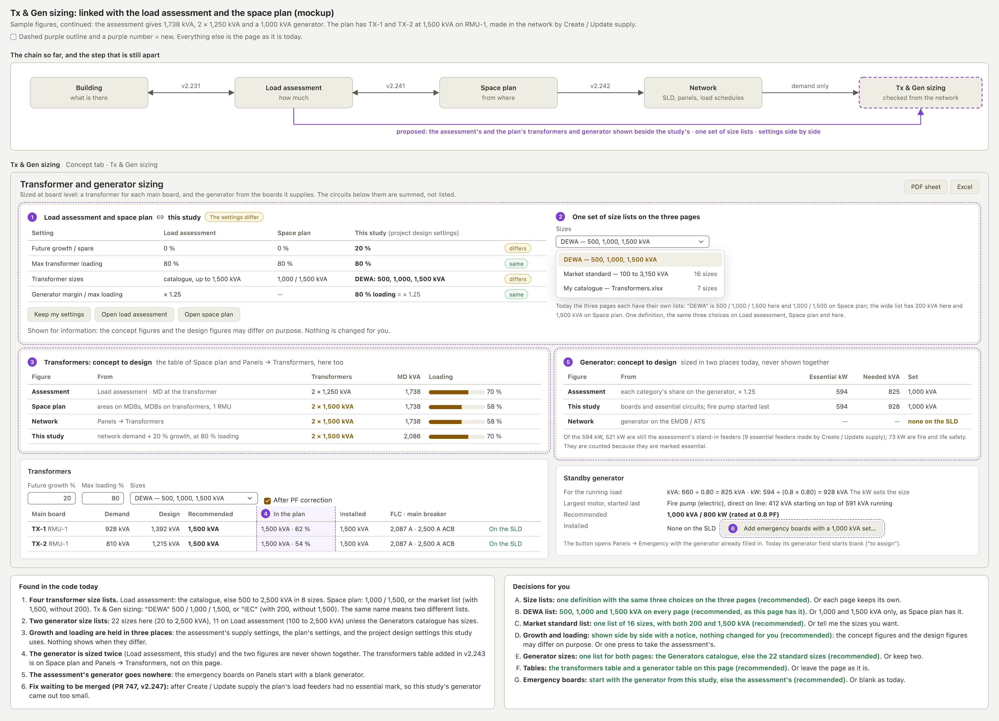

# UI UX proposal – Tx & Gen sizing linked with the load assessment and the space plan (2026-11-21)

Status: **approved 2026-11-21** — the user chose the recommended option for every decision (A–G). Built step by step, starting with one definition of the size lists.

Mockup: `docs/mockups/txgen-link-mockup.html` (image: `txgen-link-mockup.png`).

## Where this fits

Building, Load assessment and Space plan are linked (v2.230 to v2.243): what is there, how much, from where. The network is started from the plan by Create / Update supply. Tx & Gen sizing (Concept tab, also Studies) checks the transformers and the standby generator from the network demand. It is the one step of the chain that still works apart.

## Today

1. **Four transformer size lists.** Load assessment: the Transformers catalogue, else 500 to 2,500 kVA in 8 sizes (`STANDARD_TX_KVA`), or a typed list. Space plan: 1,000 / 1,500 kVA, or the market list with 1,500 and without 200 (`MARKET_TX_KVA`). Tx & Gen sizing: "DEWA" 500 / 1,000 / 1,500 (`DEWA_TRANSFORMER_KVA` in `src/calc/txGen.ts`), or "IEC" with 200 and without 1,500 (`STANDARD_TRANSFORMER_KVA` in `src/calc/sizing.ts`). The same name means two different lists.
2. **Two generator size lists**: 22 sizes in this study (`STANDARD_GENERATOR_KVA`), 11 on Load assessment (`STANDARD_GEN_KVA`) unless the Generators catalogue has sizes.
3. **Growth and loading are held in three places**: the assessment's supply settings, the plan's settings, and the project design settings this study uses (`settingsOf`). Nothing shows when they differ.
4. **The generator is sized twice** (Load assessment, this study) and the two figures are never shown together. The transformers table of v2.243 is on Space plan and Panels → Transformers, not on this page.
5. **The assessment's generator goes nowhere**: the emergency boards on Panels (`planEmergency`) start with a blank generator.
6. **Fix in PR 747 (v2.248):** after Create / Update supply the plan's load feeders had no essential mark, so this study's generator came out too small. Rows from the assessment now carry their share on the generator and become essential feeders.

## Proposed

1. **Link strip on Tx & Gen sizing**: future growth / spare, max transformer loading, transformer sizes and generator margin as Load assessment, Space plan and this study side by side, with what differs marked. For information: the concept figures and the design figures may differ on purpose, so nothing is changed for the user.
2. **One set of size lists** for Load assessment, Space plan and this page: DEWA, Market standard, My catalogue, from one definition.
3. **Transformers: concept to design table** on this page too, with a fourth row for this study (network demand with growth, at the loading limit).
4. **"In the plan" column** in the transformers table: the size and loading the space plan has for that board, beside Recommended and Installed.
5. **Generator: concept to design table**: the assessment (essential kW, needed kVA, set), this study, and the generator on the network, with a line saying how much of the essential load is still stand-in feeders.
6. **Emergency boards start with the generator**: a button here opens Panels → Emergency with the set from this study filled in; the field also starts with it when opened from Panels.

## Decisions for the user

- **A.** Size lists: one definition with the same three choices on the three pages (recommended), or each page keeps its own?
- **B.** DEWA list: 500, 1,000 and 1,500 kVA on every page (recommended), or 1,000 and 1,500 kVA only?
- **C.** Market standard list: one list of 16 sizes with both 200 and 1,500 kVA (recommended), or other sizes?
- **D.** Growth and loading: shown side by side with a notice, nothing changed (recommended), or one press to take the assessment's?
- **E.** Generator sizes: one list for both pages, the Generators catalogue else the 22 standard sizes (recommended), or keep two?
- **F.** Tables: the transformers table and a generator table on this page (recommended), or leave the page as it is?
- **G.** Emergency boards: start with the generator from this study, else the assessment's (recommended), or blank as today?

## Build steps (after approval)

1. One definition of the transformer and generator size lists, used by the three pages, with tests (decisions A, B, C, E). Saved projects keep their choice.
2. The transformers table with the study row, the "In the plan" column and the generator table (items 3, 4, 5).
3. The link strip (item 1).
4. Emergency boards start with the generator (item 6).
