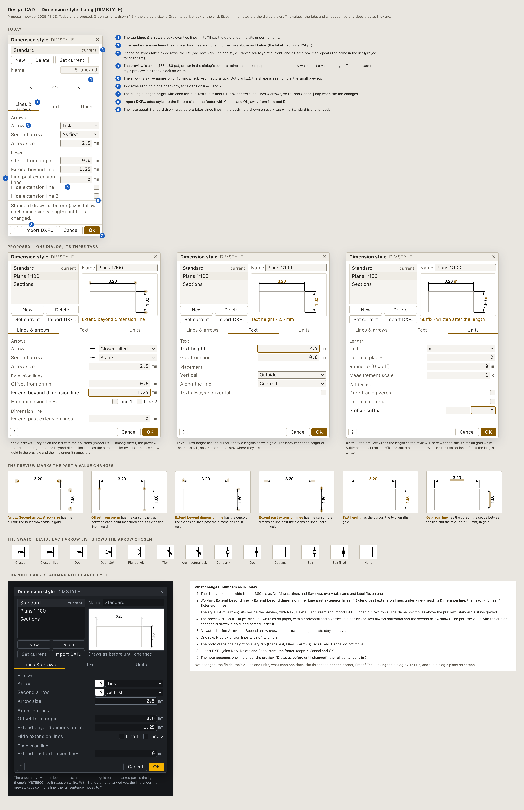

# UI UX proposal – Design CAD Dimension style dialog (2026-11-23)

Status: **approved 2026-11-23** (the recommended answer, in bold, for all five decisions); steps 1 and 2 **built** together in PR 779 (v2.268); step 3 (Text style and Multileader style) to follow.

On 2026-11-23 the user sent a screenshot of the Dimension style dialog (DIMSTYLE, Graphite light) and asked for a better design.

Mockup: `docs/mockups/cad-dimstyle-dialog-mockup.html` (image: `cad-dimstyle-dialog-mockup.png`).

## Today

The dialog is `DimStyleDialog` (`src/components/cad/CadDialogs.tsx:224`), in the compact frame every Design CAD settings dialog uses: 236 px wide (`.cad-dlg`, `src/styles.css:2298`), a label and its value on one row (label column 124 px, value 96 px). From the top: the style list, New / Delete / Set current, Name, the preview (`DimPreview`, `:385`), the tabs Lines & arrows, Text and Units, the tab's rows, the note about Standard, and ? / Import DXF… / Cancel / OK.

1. The tab **Lines & arrows** breaks over two lines in its 78 px, and the underline sits under half of it.
2. **Line past extension lines** breaks over two lines and runs into the rows above and below.
3. Managing styles takes three rows: the list (one row high with one style), the buttons, and a Name box that repeats the selected name (greyed for Standard).
4. The preview is 156 × 66 px, in the dialog's colours, with one 3.20 dimension. It does not show which part a value changes. The multileader style preview is already black on white (`:376`).
5. The two arrow lists give the names of 13 arrows, no picture.
6. Hide extension line 1 and Hide extension line 2 take a row each.
7. The dialog's height changes with the tab (the Text tab is about 110 px shorter than Lines & arrows), so Cancel and OK move.
8. Import DXF… adds styles to the list but sits in the footer with Cancel and OK.
9. While Standard is unchanged, the note "Standard draws as before (sizes follow each dimension's length) until it is changed." takes three lines on every tab.

## Proposed

The numbers follow the list above.

1. **The wide frame**, 380 px, as Drafting settings and Save As already use (`.cad-dlg.wide`, `:2328`; value column 170 px). Every tab name and label fits on one line.
2. **Wording and order.** On Lines & arrows the heading **Lines** becomes **Extension lines**, **Extend beyond line** becomes **Extend beyond dimension line**, and **Line past extension lines** becomes **Extend past extension lines** under a new heading **Dimension line**. On Text the rows get two headings: **Text** (Text height, Gap from line) and **Placement** (Vertical, Along the line, Text always horizontal). Units gets **Length** and **Written as**.
3. **Styles beside the preview.** The list (five rows high) on the left, with New, Delete, Set current and Import DXF… under it in two rows. Name moves above the preview on the right; Standard's stays greyed, as now.
4. **The preview on paper.** 188 × 104 px, black on white in both themes, as on the sheets. It shows a horizontal and a vertical dimension, so the second arrow and Text always horizontal can be seen. While a value has the cursor (or the mouse is over its row), the part it changes is drawn in gold, and the line under the preview names it: the arrowheads, the gaps at the points measured, the extension lines past the dimension line, the dimension line past the extension lines, the text, or the gap under the text. The gold is the light theme's (#875800) in both themes, so it reads on white.
5. **An arrow swatch** beside Arrow and Second arrow shows the arrow chosen. The lists stay as they are (decision 3).
6. **One row: Hide extension lines** with two checkboxes, Line 1 and Line 2. Prefix and suffix also share one row.
7. **One body height** on every tab (the tallest, Lines & arrows), so Cancel and OK stay where they are.
8. **Import DXF…** joins the style buttons. The footer keeps ?, Cancel and OK.
9. **The Standard note in one line** under the preview: "Draws as before until changed". The full sentence moves into ?. The import note and error lines stay as today, above the footer.

Not changed: the fields, their values and units, what each does, the three tabs and their order, Enter and Esc, moving the dialog by its title, and where it opens. The labels the screen reader reads stay as today (for example "Hide extension line 1", "Prefix", "Suffix", "Import dimension styles").

## Decisions

1. Size: **the 380 px wide frame with the styles beside the preview**, or keep 236 px and only shorten the labels that wrap?
2. Preview: **black on white, two dimensions, the part being set in gold**, the same without the gold mark, or as today?
3. Arrows: **a swatch beside each list**, a list with a picture on every entry (a new list control with its own keyboard handling), or names only as today?
4. Wording: **the renames and headings in item 2**, or today's words?
5. Text style and Multileader style use the same style list: **give them the same top area in a later step**, or change Dimension style only?

Answered 2026-11-23: the answer in bold for all five.

## Steps once approved

1. **Layout** (items 1–3 and 6–9): `DimStyleDialog` and a side-by-side form of `StyleList` in `CadDialogs.tsx`, rules under `.cad-dlg.dim` in `styles.css`, and the tests in `DimStyleDialog.test.tsx`.
2. **Preview and swatches** (items 4–5): `DimPreview` on white with both dimensions from `dimOf`, each row naming the part it changes, and the swatch drawn by the same arrow code. Tests: the part marked follows the value that has the cursor.
3. If decision 5 says so: Text style and Multileader style.

Built 2026-11-23 (PR 779, steps 1 and 2 in one PR):
- As proposed. The value with the cursor wins over the row under the mouse, so the part marked is the one being typed; with no value in use, the row under the mouse is marked. A hidden extension line shows dashed while its row is marked. Units rows mark the whole length written.
- The preview's vertical dimension sits on the room's left wall, not the right as in the mockup. With Outside text, a dimension whose line is on the side that is down as its text reads (below a horizontal dimension's points, or right of a vertical one reading bottom to top) has its text across its line, on the canvas and on the sheets alike. That is an engine fault older than this dialog, to be fixed on its own.
- The user also asked (2026-11-23) how to set the text position: Text tab → Placement → Vertical (Outside, Above, Centred, Below) and Along the line (Centred, At extension line 1, At extension line 2) for new dimensions; right-click a drawn dimension → Dimension tools → Text position for one already drawn.

Related: [[UI UX proposals - 2026-11-16 - CAD edit previews and repeat]], [[CAD dimension styles - DWG import and DXF export - 2026-11-08]].
