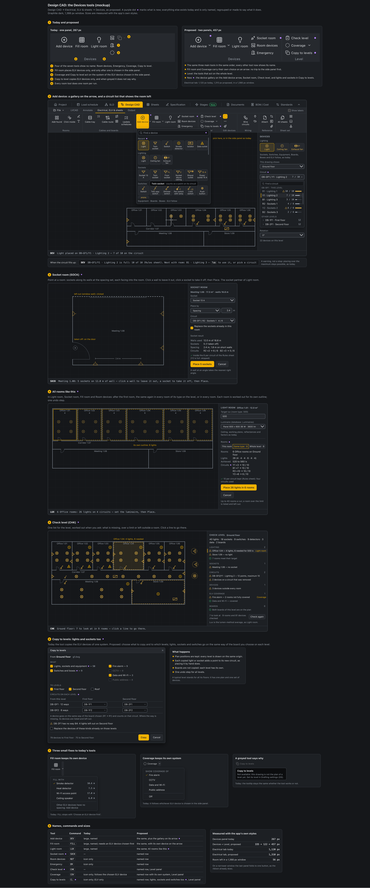

# UI UX proposal – Design CAD Devices tools (2026-11-23)

Status: **approved 2026-11-23** ("go with recommendation": decisions A–F as recommended). Built so far: steps 1 (v2.275), 2 (v2.291), 3 (v2.307), 4 (v2.308 Fill room and Light room, v2.309 Room devices) 5 (v2.310) and 6 (v2.312); all six steps are built.

Mockup: `docs/mockups/cad-devices-panel-mockup.html` (image: `cad-devices-panel-mockup.png`).

## Today

The user sent a picture of Design CAD → Electrical, ELV & sheets → Devices and asked to check the tools, draw a better version and add new features. The panel (`src/components/Ribbon.tsx`, group `devices`) has seven tools: Add device (DEV), Fill room (FILL) and Light room (LUX) as large named buttons, and Room devices (RDT), Emergency (EM), Coverage (COV) and Copy to level as small icons.

What the check found:

1. Four of the seven tools show no name. Electrical is the one Design CAD tab whose small tools are icons only (`CAD_TABS.named`: no `smallNamed`).
2. Fill room places ELV devices only, and only after one is chosen in the side panel. With a light or socket chosen it stops with "Choose an ELV device first" (`CadPage.tsx`, tool `fill`).
3. Coverage and Copy to level act on the system of the ELV device chosen in the side panel (`elvSystemOf`, fire alarm when none is chosen). Nothing on the ribbon says which system that is.
4. Copy to level copies ELV devices only (`elvPlan.ts:copyTo`). When it is greyed, its tooltip does not say why.
5. Add device: 35 devices in a side-panel list, with no search and no recent ones. The circuit list is every final circuit of the project in one list (`finalCircuits`), without the points already on each. Placing reports "7 on the circuit" but not the Rules-sheet maximum; a circuit over it is warned about only when devices are moved to it (`deviceEdit.ts:circuitAfter`).
6. Fill room, Light room and Room devices do one room per run. "Light all rooms on the level" (Light room note, 2026-11-03) and "Batch apply to many rooms" (Room device templates decision, 2026-11-20) were left for later.
7. Lights, sockets and switches cannot be copied to another level.
8. There is no check of a whole level. Lux check is per room on the right-click menu, Coverage is a picture, and the circuit maximum is checked only on a move.
9. Seen while checking: on the Graphite theme LV points (`--cad-dev`, #f5c04a) and ELV devices (`--cad-elv`, #f5b301) are drawn in almost the same yellow. See decision F.

Measured with the app's own styles (the ribbon drawn off screen): the Devices panel is 267 px wide and the Electrical tab 1,120 px.

## Proposed

### The panels

Two panels in place of one. The three main tools stay large, named and in the same order.

| Panel | Tools |
|---|---|
| Devices | **Add device** (arrow: device gallery, new) · **Fill room** (arrow: its own ELV device) · **Light room** · rows: Socket room (new), Room devices, Emergency |
| Level | rows: Check level (new), Coverage (arrow: its own system), Copy to levels (lights and sockets too, new) |

- Every tool shows its name. Only these two panels name their small tools: naming every small tool of the tab would need about 1,760 px.
- Fill room and Coverage keep their own choice on an arrow, so they no longer depend on the side panel. Fill room starts with Smoke detector.
- A greyed tool says why in its tooltip.
- Width: Devices 335 px + Level 122 px = 457 px (267 px today). The Electrical tab grows from 1,120 px to 1,310 px, inside a 1,366 px window with 56 px to spare. After this the tab is full: the next tool added there needs a move or a fold.
- With Show labels on, the Electrical & ELV tab is 1,543 px today, so its last panels already fold on a 1,366 px window. The two panels add about 45 px there (1,590 px as built).

### New tools

1. **Device gallery** on the Add device arrow: Find, the six devices used last, then the same groups as the side panel. The side-panel list stays as it is.
2. **Circuit list with the room left**, in the Add device panel: the boards of this level first, each circuit with its points against the Rules-sheet maximum ("7 / 10"), a filter, full circuits marked. When the circuit in use fills up, the command line names the next circuit with room, and Tab takes it. A warning, not a stop, as today.
3. **Socket room (SOCK)**: point at a room; sockets along its walls at the spacing typed, each turned to face into the room (right angles, as the saved rotation allows). Click a wall to leave it out, click a socket to take it off, then Place. The circuits used show before placing; a full circuit is skipped.
4. **All rooms like this**, in Light room, Socket room, Fill room and Room devices: This room · Same type on the level · Whole level. Each room is worked out for its own outline. Lights and sockets go on to the next circuit with room at the Rules-sheet maximum. One undo step, and a fixed limit of rooms and points a run, in keeping with the limits of Room devices. **Built for Fill room and Light room (v2.308).** Each room's lights go on one circuit (a room is not split over two); a room that fits on none is listed and left out. Room devices followed (v2.309), with a limit of 400 devices a run.
5. **Check level (CHK)**: one list for the level, worked out on demand. Rooms short of lights by the lumen method or with none, rooms with no socket, circuits over the Rules-sheet maximum, devices on a removed circuit, devices outside every room, ELV coverage gaps by system, boards of the level not on the plan, and the counts by type. A line goes to its place on the plan; some lines open the tool that fixes them.
6. **Copy to levels** for lights, sockets and switches too: choose what to copy and to which levels; for each board of this level choose the board on the other level. A device goes on the same way of that board and counts on that circuit. Devices whose way is missing are listed and left out.

All six keep the rule of 2026-11-03: nothing is read from the architect's drawing on its own. The engineer points at rooms and walls; the app places, counts and checks. All are 2D plan work.

### Not in this proposal

- Light switches linked to their lights (C8 SWLINK), device tags (C5 DTAG) and a count table on the plan (C6 COUNT): see *CAD drafting macros as built-in commands (2026-11-09)*. A Tag tool would need a place on these panels when it is built.
- Own templates for Room devices (left for later in the 2026-11-20 decision).
- Mounting heights, and anything in elevation or 3D.
- The other panels of the Electrical tab: their small tools stay icons.

## Decisions (all as recommended, 2026-11-23)

A: two panels as drawn. B: the names as drawn. C: all six tools, in the order of the build steps. D: warn and offer the next circuit with room. E: decided when step 6 is built. F: a small proposal of its own, with samples.

As they were asked:

- **A. Arrangement.** Two panels, Devices and Level, as drawn (recommended), or keep one panel and only add the names?
- **B. Names.** "Socket room", "Check level", "Copy to levels" and the panel name "Level" as drawn (recommended), or other words?
- **C. New tools.** All six in the order of the build steps (recommended). Any to drop, or to move up?
- **D. A circuit at its maximum.** Warn and offer the next circuit with room (recommended; it matches the warn-only rule built for moving devices, still open in the Device edit tools note), or stop placing at the maximum?
- **E. Typical levels.** A typical level has one plan and one set of devices for all its floors, while each floor has its own boards. Should Copy to levels also put the same points on the boards of the other floors of a typical level? Recommended: decide with step 6, after a look at the load schedule side. **Decided with step 6 (v2.312): no.** Copy to levels works plan to plan and a typical level is one plan: the board chosen takes the points, the boards of its other floors are not changed. Putting the same points on those boards needs a link between the boards of a typical level on the load schedule side: a separate proposal, not built.
- **F. Colours.** Give ELV devices a colour of their own on Graphite, or leave them as they are? Recommended: a small proposal of its own, with samples. **Proposal written (2026-11-26):** `UI UX proposals - 2026-11-26 - ELV device colour.md`. **Approved (2026-11-26):** A, rose, Coverage circles follow. **Built (v2.320).**

## Build steps

1. The two panels with names, the arrows of Fill room and Coverage, tooltips that say why a tool is greyed, and the device gallery. Screen only. **Built (v2.275).** As built the Electrical tab measures 1,320 px: Copy to level keeps its arrow (a list of levels) until step 6. A panel order saved earlier gets Level right after Devices. The six devices placed last are kept per computer.
2. Circuit list with the room left, and the next circuit with room on the command line. **Built (v2.291).** Each circuit shows the type it carries (a socket circuit shows its sockets even while a light is being placed); the next circuit offered is one that already carries the type, or an empty one.
3. Check level. **Built (v2.307).** The lights a room needs come from the Light room settings, as Lux check; ELV coverage is listed for the systems that have devices on the level.
4. All rooms like this: Fill room first (no circuits), then Light room and Room devices.
5. Socket room. **Built (v2.310).** One room per run; the spacing is typed (it starts at 3 m), and a socket takes the nearest right angle to its wall.
6. Copy to levels for lights, sockets and switches. **Built (v2.312).** A window in place of the arrow; a way that holds other points still takes the copies, with a note.

One PR per step, each with its tests. Steps 3, 5 and 6 add a typed command (CHK, SOCK, CL) and steps 3 to 5 an entry on a room's right-click menu.
