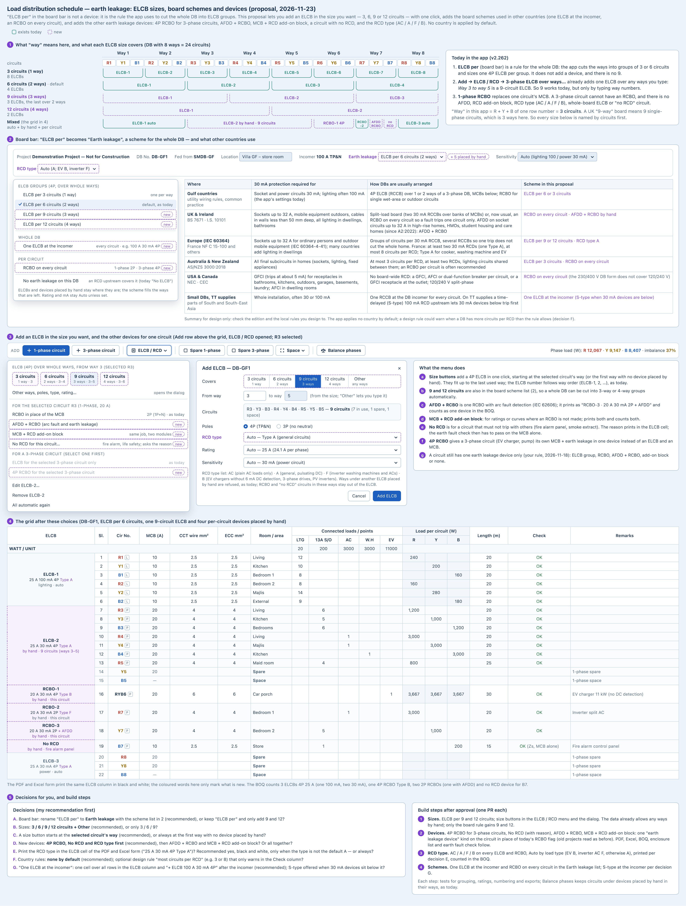

# UI UX proposal – Load schedule earth leakage: ELCB sizes, board schemes and devices (2026-11-23)

Status: **approved on 2026-11-23** ("ok go ahead" to the recommended plan below). Steps 1, 2, 3a and 3b merged (PRs 782, 792, 799, 800; 2026-11-24/25); step 4 (RCD type) in PR 807 (v2.303); step 5 waits.

Mockup: `docs/mockups/load-schedule-earth-leakage-mockup.html` (image: `load-schedule-earth-leakage-mockup.png`).

## What the user asked

The user sent a crop of the board bar's **ELCB per [6 circuits (2 ways)]** list: "this is not what I expected; it makes the ELCB 6 or 3 way in the load schedule, but I want to add an ELCB with 6 or 3 ways. Is 9 ways available? What do other countries use: an ELCB on each circuit, or only on the main board? What if I want an RCBO or another device? Give an idea and a mockup."

## Today (v2.262)

- **ELCB per** (`Board.elcbGroupSize`: 0, 3 or 6) is a rule for the whole DB. `elcbSections` cuts the ways into groups of 1 or 2 ways and `elcbGroups` sizes one 4P ELCB per group. It does not add a device, and there is no 9 or 12.
- **Add → ELCB / RCD → 3-phase ELCB over ways…** (`Board.elcbs`, `addBoardElcb`, since v2.201) already places one ELCB over any ways the user types: way 3 to way 5 is a 9-circuit ELCB. The dialog asks way numbers only, so the size is not obvious.
- **1-phase RCBO** (`Feeder.rcbo`) replaces one circuit's MCB. A 3-phase circuit cannot have an RCBO (`isRcbo` excludes RYB). There is no AFDD, RCD add-on block, RCD type (AC / A / F / B), whole-board ELCB or "no RCD" circuit.
- A **way** in this app is R + Y + B of one row number, 3 circuits. A UK "9-way" board means 9 single-phase circuits, which is 3 ways here. The proposal names every size by circuits first.

## What other countries use (summary for design only)

| Where | 30 mA protection required for | How DBs are usually arranged |
|---|---|---|
| Gulf countries (utility wiring rules, common practice) | Socket and power circuits 30 mA; lighting often 100 mA (the app's settings today) | 4P ELCB (RCCB) over 1 or 2 ways of a 3-phase DB, MCBs below; RCBO for single wet-area or outdoor circuits |
| UK and Ireland (BS 7671, I.S. 10101) | Sockets up to 32 A, mobile equipment outdoors, cables in walls less than 50 mm deep, all lighting in dwellings, bathrooms | Split-load board (two 30 mA RCCBs) or, now usual, an RCBO on every circuit. Since A2:2022, AFDDs on single-phase socket circuits up to 32 A in high-rise residential buildings, HMOs, student housing and care homes, so AFDD + RCBO there |
| Europe (IEC 60364; France NF C 15-100 and others) | Sockets up to 32 A for ordinary persons and outdoor mobile equipment (IEC 60364-4-41); many countries add lighting in dwellings | Groups of circuits per 30 mA RCCB, several RCCBs so one trip does not cut the whole home. France: at least two 30 mA RCDs (one Type A), at most 8 circuits per RCD |
| Australia and New Zealand (AS/NZS 3000:2018) | All final subcircuits in homes | At most 3 circuits per RCD, at least two RCDs, lighting circuits shared between them; an RCBO per circuit is often recommended |
| USA and Canada (NEC, CEC) | GFCI (about 5 mA) for receptacles in bathrooms, kitchens, outdoors, garages, basements, laundry; AFCI in dwelling rooms | No board-wide RCD: a GFCI, AFCI or dual-function breaker per circuit, or a GFCI receptacle; 120/240 V split-phase (outside the 230/400 V DB form) |
| Small DBs and TT supplies (parts of South and South-East Asia) | Whole installation, 30 or 100 mA | One RCCB at the DB incomer; on TT supplies a time-delayed (S-type) 100 mA RCD upstream lets 30 mA devices below trip first |

Check the edition and local rules of each project; the app applies no country by default and prints no authority name.

## Follow-up questions on 2026-11-23

- **"What is by hand?"** An ELCB or RCBO the user placed from Add → ELCB / RCD, as opposed to one made by the "ELCB per" rule. The agreed plan removes the difference, so "by hand" and "auto" leave the schedule.
- **3 circuits at 30 mA and 3 at 100 mA under "ELCB per 6".** Today the six share one ELCB: the app picks 30 mA (it protects both) and marks the cell "mixed!". Balance phases separates them, but it renumbers circuits and leaves half-empty ELCBs. The user wants the automatic grouping to avoid the mix.
- **"Selecting 3 changes every ELCB to 3, and 6 changes every one to 6; that's not good."** True for a DB with no ELCBs placed by hand, which is almost every DB, because the dialog for placing them is hard to find. One click re-cuts the whole board: numbers, ratings, PDF and BOQ all change.

## Agreed plan (2026-11-23)

1. **Every ELCB is its own device.** Click an ELCB cell, or use ELCB / RCD with a circuit selected, and pick 3, 6, 9 or 12 circuits. Only that ELCB and its neighbour change. Bigger takes ways from the next ELCB, which gets smaller (an ELCB left with no ways is removed). Smaller gives its freed ways an ELCB of their own.
2. **The board-bar list becomes "New ELCBs":** the size (3 / 6 / 9 / 12 circuits, or none) for ways that have no ELCB yet. Changing it never changes the ELCBs already on the DB. **Re-group all ELCBs…** re-cuts the whole DB after showing before and after, and Undo reverses it.
3. When the app makes ELCBs (new ways, Re-group) it **keeps 30 mA and 100 mA circuits apart.** A way with one odd circuit gets **Make RCBO** in the Check column, so its ELCB can stay at 100 mA for the lights. This is on by default; Re-group has a switch, because some rules (AS/NZS 3000) want lighting circuits spread over RCDs.
4. **Devices for one circuit:** 4P RCBO and No RCD (with a reason) first, then AFDD + RCBO and MCB + RCD add-on block. One earth leakage device per circuit (the user's rule of 2026-11-18).
5. **RCD type** AC / A / F / B, set from the load (EV charging B, or A when the charger has 6 mA DC detection; inverter AC F; otherwise A). Printed in black and white only when it is not Type A.
6. **Whole-board schemes** (one ELCB at the incomer, with S-type when 30 mA devices sit below it; RCBO on every circuit) last, as choices in Re-group.
7. **No country rule by default.** Old projects open with exactly the ELCBs they print today.
8. **Balance phases** swaps R, Y and B only inside each ELCB, so every ELCB keeps its circuits and its size.

## Build steps (one PR each)

1. **ELCB as its own device:** click to resize, New ELCBs 3 / 6 / 9 / 12, Re-group all ELCBs…, Balance phases inside each ELCB. Data: the automatic sections are written into `Board.elcbs` before any ELCB is resized or the New ELCBs size changes, so nothing already on the DB moves; `elcbGroupSize` gains 9 and 12 and covers only ways with no ELCB.
2. **Keep 30 mA and 100 mA apart** when ELCBs are made, and Make RCBO for one odd circuit. Built: `Board.elcbKeepApart` is set the first time a DB's ELCBs are changed (every circuit is under an ELCB then, so nothing moves) and by Re-group; with it, automatic ELCBs on new ways end where lighting and power meet. Old projects keep their ELCBs until one is changed. Make RCBO is offered for a single odd 1-phase circuit (power first when there is one of each).
3. **Devices:** one earth leakage device kind on the circuit in place of the `rcbo` flag (old projects read as RCBO); 4P RCBO for RYB circuits; No RCD; then AFDD + RCBO and MCB + RCD add-on block. PDF, Excel, BOQ, enclosure list and earth fault check (`rcdOf`) follow.
4. **RCD type** on `BoardElcb`, the board and the circuit device; counted in the BOQ. Built: Auto is Type B when a circuit's remarks name an EV charger, a 3-phase drive (or a VFD starter) or PV, Type F for a 1-phase drive, else Type A; an ELCB takes the strictest its circuits need. The app cannot tell an inverter air conditioner from its points, so Type F for one is chosen by hand. Printed (schedule, PDF, Excel, BOQ) only when it is not Type A, so old projects print as before unless a remark names one of those loads.
5. **Whole-board schemes** in Re-group.

Each step adds tests for grouping, numbering, ratings and exports.
