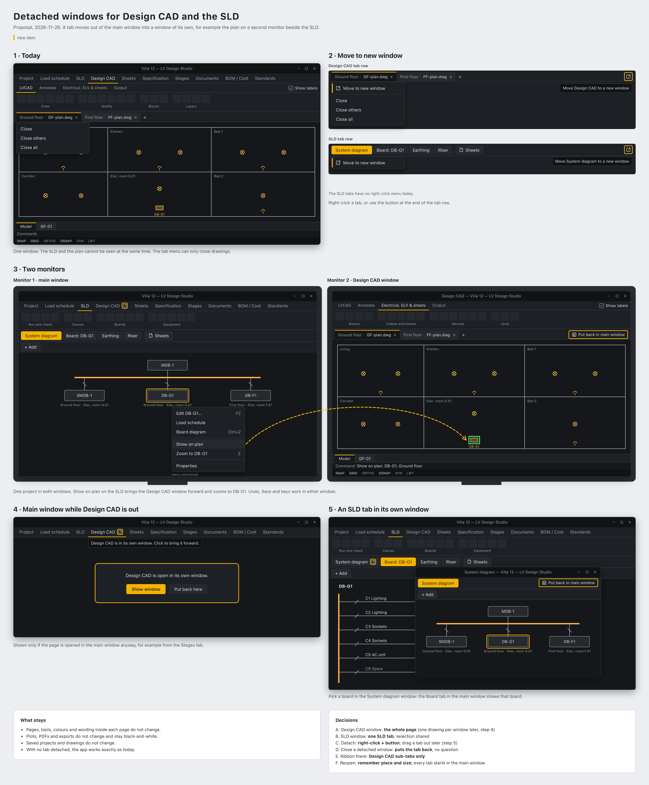

# UI UX proposal – Detached windows for Design CAD and the SLD (2026-11-26)

Status: **Approved 2026-11-26: the user answered "Go ahead" to the recommendations (A1, B1, C1, D1, E1, F1). Step 0 (the check) passed the same day; step 1 is being built.**

The user asked for a detached tabs option in Design CAD and the SLD. A detached tab moves out of the main window into a window of its own. For example, the plan can sit on a second monitor beside the SLD.

Mockup: `docs/mockups/detached-windows-mockup.html` (image: `detached-windows-mockup.png`).

## Today

- The app has one window. Electron creates exactly one (`electron/main.cjs:74`) and refuses any other window the page asks for (`setWindowOpenHandler`, `main.cjs:94`). Only that window may call the main process (`electron/trust.cjs:52`, `event.sender !== win.webContents`).
- One page shows at a time: `view` in `src/App.tsx:337`. Design (SLD) is drawn at `App.tsx:1699` and Design CAD at `App.tsx:1976`. Opening the SLD hides the plan, and opening the plan hides the SLD.
- Design CAD has one tab for each open drawing (`CadTabs.tsx`). The tab's right-click menu has only Close, Close others and Close all. One drawing shows at a time (`Tabs.shown`, `cadState.ts:101`).
- The SLD has four tabs: System diagram, Board, Earthing and Riser (`diagramMode`, `App.tsx:1706–1719`). One shows at a time. These tabs have no right-click menu.
- The SLD has Full screen inside the window (`sldFull`, `App.tsx:1157`). Design CAD has no Full screen.
- The project, its undo list (`useHistory`, `App.tsx:234`) and the open drawings live in this one page.
- With two monitors, the user can only stretch the one window across both.

## Proposed

### What the user sees

1. **Move to new window** is added to a tab's right-click menu. It works on a drawing tab in Design CAD and on the System diagram, Board, Earthing and Riser tabs of the SLD. A small button at the right end of each tab row does the same for the tab showing; in Design CAD it sits after **+**. (Decision C)
2. The tab opens in a window of its own. The window can move to another monitor, be resized and be maximised. Its title names the page and the project, for example "Design CAD — Villa 12 — LV Design Studio" or "System diagram — Villa 12 — LV Design Studio".
3. **A Design CAD window** holds the whole Design CAD page: its ribbon sub-tabs (LVCAD, Annotate, Electrical, ELV & sheets, Output), the drawing tabs, the drawing, the layout tabs, the command line and the status bar. (Decisions A and E)
4. **An SLD window** holds one SLD tab, with the SLD command bar (+ Add, results) and, on System diagram and Board, the equipment strip. The main window's SLD page keeps the other tabs. (Decision B)
5. **One project in both windows.** A change made in one window shows in the other straight away. When the user picks a board in the System diagram window, the Board tab in the main window shows that board. **Show on plan** from the SLD brings the Design CAD window forward and zooms to the board or device there; it no longer switches the main window to Design CAD.
6. **Undo, Save and keys work in either window.** Ctrl+Z undoes the last change to the project, whichever window made it. Ctrl+S saves the project. Keys go to the window the user is working in.
7. **The main window while a tab is out.** The ribbon's Design CAD tab, or the SLD tab that is out, carries a small window mark. A click on it brings the window forward. If the page is opened in the main window anyway (for example from the Stages tab), it shows one line: "Design CAD is open in its own window", with **Show window** and **Put back here**.
8. **Putting a tab back.** The detached window has **Put back in main window** at the right end of its tab row and on the tab's right-click menu. Closing the window with × does the same. Nothing is lost: the tab returns to the main window as it was. (Decision D)
9. **Closing the main window** closes the detached windows too, with the same unsaved-changes question as today. Before another project opens, detached tabs go back to the main window.
10. **Remembered place.** Each kind of detached window opens where it was last time: the same monitor, position and size, kept on this computer. If that monitor is not connected, it opens on the main window's monitor. (Decision F)
11. **Web version.** It works the same in a browser pop-up window. The first time, the browser may ask to allow pop-ups for the site. In the browser, the browser decides where the window opens.

### What stays

- The layout, colours, wording and tools inside each page do not change. The new window uses the same theme and follows a theme change at once.
- Plots, PDFs and exports do not change and stay black-and-white.
- Saved projects and drawings do not change. Which tabs are detached is not saved in the project file.
- SLD Full screen stays as it is, inside whichever window shows the System diagram.
- With no tab detached, the app looks and works exactly as today.

## How it would be built

**Recommended: the main window draws the detached page into a plain window that it opens.**

- The main window's page opens a blank window and draws the detached page into it (a React portal into that window's document). The detached page stays part of the main window's app, so there is one project, one undo list and one copy of each drawing in memory. Nothing has to be copied or kept in step between windows.
- Security stays as it is. The detached window has no bridge of its own to the main process. Disk, print and Python work still goes through the main window, which `trust.cjs` already allows. In `main.cjs`, `setWindowOpenHandler` lets through only this blank window (`about:blank` with the app's own window name) with the same sandbox settings. The new window cannot navigate or open other windows.
- Some code has to change so that it works in the window the page is in:
  - Listeners on the window and uses of `document`: about 25 `window.addEventListener` calls and 15 `document.` uses in `App.tsx`, `CadPage.tsx`, `CadCanvas.tsx`, `Ribbon.tsx`, `SystemDiagram.tsx` and `SheetWorkspace.tsx`.
  - Menus and pop-ups that open on `document.body`, for example `ColourPicker.tsx:167`.
  - The canvas pixel ratio, when the second monitor has a different scale (`CadCanvas.tsx`), and animation frames.
  - The app's styles and theme class, which are copied into the new window.
  - The app-wide keys in `App.tsx` (from line 1400): they follow the page of the window that has focus, not `view`.
- The main window must not slow down while it is minimised, because the detached page runs in the main window's process. Electron's `backgroundThrottling` is turned off for the main window. Step 0 checks this.

**Not recommended: a second full copy of the app in the second window, with every change sent across.** This would mean two undo lists, edits that can cross, every open drawing loaded twice by the CAD engine, and `trust.cjs` opened to a second window that can call the main process.

## Decisions

- **A. What a Design CAD window holds.**
  - A1 (recommended): the whole Design CAD page with all its drawings. The main window then shows the other pages.
  - A2: one drawing per window from the start, while the main window keeps the other drawings (two plans side by side). A2 needs a second copy of the CAD page's own state (tool, selection, layout, pick box and the like) for each window, so it is proposed as step 4.
  - **Approved: A1.**
- **B. What an SLD window holds.**
  - B1 (recommended): one SLD tab (System diagram, Board, Earthing or Riser). The main window keeps the other tabs, and the selection is shared.
  - B2: the whole SLD page.
  - **Approved: B1.**
- **C. How to detach.**
  - C1 (recommended): Move to new window on the right-click menu, plus a button at the end of the tab row. Dragging a tab out of the window comes in step 5.
  - C2: dragging a tab out from step 1.
  - **Approved: C1.**
- **D. Closing a detached window.**
  - D1 (recommended): it puts the tab back with no question.
  - D2: it asks first.
  - **Approved: D1.**
- **E. The ribbon in a Design CAD window.**
  - E1 (recommended): only the Design CAD sub-tabs (LVCAD, Annotate, Electrical, ELV & sheets, Output). The main window keeps its full ribbon.
  - E2: no ribbon; only the command line and right-click menus.
  - **Approved: E1.**
- **F. Opening detached windows again.**
  - F1 (recommended): the place and size are remembered on this computer, but every tab starts in the main window when the app starts. Detaching again is one click, and no window can be lost off screen.
  - F2: the windows that were detached when the project was last closed open again by themselves.
  - **Approved: F1.**

## Step 0 results (2026-11-26)

A hidden Electron test page (not the app), with the app's window settings, was loaded both as a file page (like the packaged app) and from a local development server. Every check passed in both:

- Only a blank window with the app's own window name opens. Other names, outside pages and file pages are refused.
- The main page can draw into the new window, and a React portal there works: a real click in the new window changed the main page's state, and real keys reached the portal.
- The new window gets no bridge to the main process (`window.lvds` is missing there), while the main window's bridge still works.
- Copied styles and the theme apply in the new window, and a theme change follows at once. A canvas draws there.
- The new window can't go to another page, and its own attempts to open windows are refused. This needs its own rule: the new window does **not** inherit the main window's rule.
- Closing the new window is seen by the main page at once, and the portal closes without errors. Closing the main window closes the new window too.
- The new window runs in the main window's process and adds about 18 MB of memory.

Two findings change the build:

- **Type checks across windows.** An element in the new window is not an `HTMLElement` of the main page (`instanceof` gives false), so checks must use the element's own window or `nodeType`. About 17 such checks exist in the CAD page, its dialogs, the ribbon and `App.tsx`.
- **Speed while the main window is minimised** could not be measured with hidden windows: they count as visible. The main window therefore keeps full speed while a detached window is open (`setBackgroundThrottling(false)`), and the CAD page uses its own window's animation frames.

## Steps once approved

0. **Check that it works (no screen change, no version bump).** A blank window drawn by the main page is tried in the packaged desktop app (file page), in development and in the web version. The checks are: the canvas and keys work in it, the main window keeps its speed while minimised, and the memory with a 3 MB drawing is measured. The results go in a short note. If the check fails, the work stops and a second-copy design comes back with its costs.
1. **Design CAD in its own window** (A1, C1, D1, E1). This step adds the Electron window rule, the window host (styles, theme, place and size), and window-aware listeners in the CAD page, canvas and ribbon. It also adds Move to new window on the drawing-tab menu, Put back, and the main window's line. Show on plan and Show on SLD bring the right window forward. Tests: the window rule, the host in jsdom, and keys in the window that has focus.
2. **An SLD tab in its own window** (B1). This step adds the diagram tab per window, the SLD listeners, the equipment strip and menus in the window, and the Board tab that follows the board picked in the other window.
3. **Remembered places** (F) and the web pop-up wording.
4. **One drawing per window** (A2). The CAD page's own state is split per window, so two plans can sit side by side. A drawing is open in one window at a time, and a tab can move between windows.
5. **Drag a tab out to detach it, and onto a tab row to put it back** (C2).

Each step is one PR, with a version bump and a What's new line.
