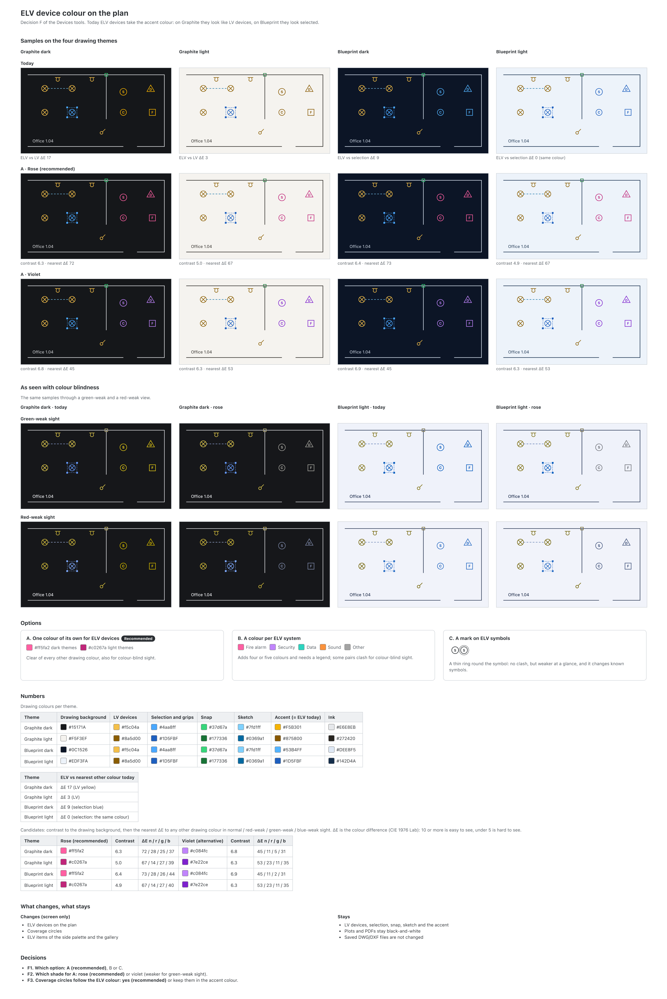

# UI UX proposal – ELV device colour (2026-11-26)

Status: **Approved 2026-11-26: the user answered "Go with recommendation" (F1 A, F2 rose, F3 yes). Being built.**

Decision F of the Devices tools proposal (2026-11-23).

Mockup: `docs/mockups/cad-elv-colour-mockup.html` (image: `cad-elv-colour-mockup.png`).

## What is wrong today

- On the plan, LV devices use `--cad-dev` and ELV devices use `--cad-elv` (`CadCanvas.tsx`; set in `src/styles.css` in `.cad` and `.cad-gallery`). The side palette and the gallery use the same two.
- `--cad-elv` is the theme's accent colour, the colour of focus and of the cursor halo.
- Colour difference (ΔE) between ELV devices and the nearest other drawing colour: Graphite dark 17 (LV yellow), Graphite light 3 (LV), Blueprint dark 9 (selection blue), Blueprint light 0 (selection: the same colour).
- So on Graphite, ELV and LV devices look alike. On Blueprint, an ELV device looks selected.

## Options

- **A. One colour of its own for ELV devices (recommended).** Rose: #ff5fa2 on the dark themes, #c0267a on the light themes. Clear of LV yellow, the selection blue, snap green, sketch blue, the accent and the ink, also for colour-blind sight (nearest ΔE 14 or more); contrast 4.9–6.4 to the drawing. Coverage circles, the side palette and the gallery follow, as they use the ELV colour today. With red-weak or green-weak sight the rose looks grey (see the mockup): neither yellow nor blue, the only room left on a plan where yellow is LV and blue is selection. It stays apart from the ink by lightness, and the letters on the ELV symbols tell the devices apart.
- **B. A colour per ELV system** (fire alarm, security, data, sound): tells the systems apart at a glance, but adds four or five colours to a plan that already uses yellow, blue, green and light blue, needs a legend, and some pairs would clash for colour-blind sight. Not recommended now; it could follow later on its own.
- **C. No new colour: a mark on ELV symbols** (a thin ring round the symbol): no colour clash, but weaker at a glance and it changes symbols users know. Not recommended.

## What changes, what stays

- **Changes (screen only):** ELV devices, Coverage circles and the ELV items of the side palette and gallery.
- **Stays:** LV devices, selection, snap, sketch and the accent. Plots and PDFs stay black-and-white. Saved DWG/DXF files are not changed.

## How it would be built (after approval)

One new token `--elv-dev` in `src/theme/tokens.css` (`:root` #ff5fa2, light #c0267a; the Blueprint pair takes the same values), `--cad-elv:var(--elv-dev)` in the two `src/styles.css` rules named above, the canvas fallback colours in `CadCanvas.tsx`, and a token test for contrast. One small PR.

## Decisions

- **F1. Which option:** A (recommended), B or C. **Approved: A.**
- **F2. Which shade for A:** rose (recommended) or violet (weaker for green-weak sight). **Approved: rose.**
- **F3. Coverage circles follow the ELV colour:** yes (recommended) or keep them in the accent colour. **Approved: yes.**

## Checks behind the numbers

Contrast is to the drawing background. ΔE is to the nearest other drawing colour, in normal / red-weak / green-weak / blue-weak sight.

| Theme | Rose (recommended) | contrast | ΔE n / r / g / b | Violet (alternative) | contrast | ΔE n / r / g / b |
|---|---|---|---|---|---|---|
| Graphite dark | #ff5fa2 | 6.3 | 72 / 28 / 25 / 37 | #c084fc | 6.8 | 45 / 11 / 5 / 31 |
| Graphite light | #c0267a | 5.0 | 67 / 14 / 27 / 39 | #7e22ce | 6.3 | 53 / 23 / 11 / 35 |
| Blueprint dark | #ff5fa2 | 6.4 | 73 / 28 / 26 / 44 | #c084fc | 6.9 | 45 / 11 / 2 / 31 |
| Blueprint light | #c0267a | 4.9 | 67 / 14 / 27 / 40 | #7e22ce | 6.3 | 53 / 23 / 11 / 35 |

ΔE is the CIE 1976 Lab colour difference (10 or more is easy to see, under 5 is hard to see). Colour-blind views are simulated with the Machado 2009 matrices at full strength.

Orange, coral and teal were checked and dropped: orange and coral come near LV yellow or snap green for green-weak sight (ΔE 8–10), teal near snap green for blue-weak sight (ΔE 5). Violet comes near the selection blue for green-weak sight (ΔE 2–11).
