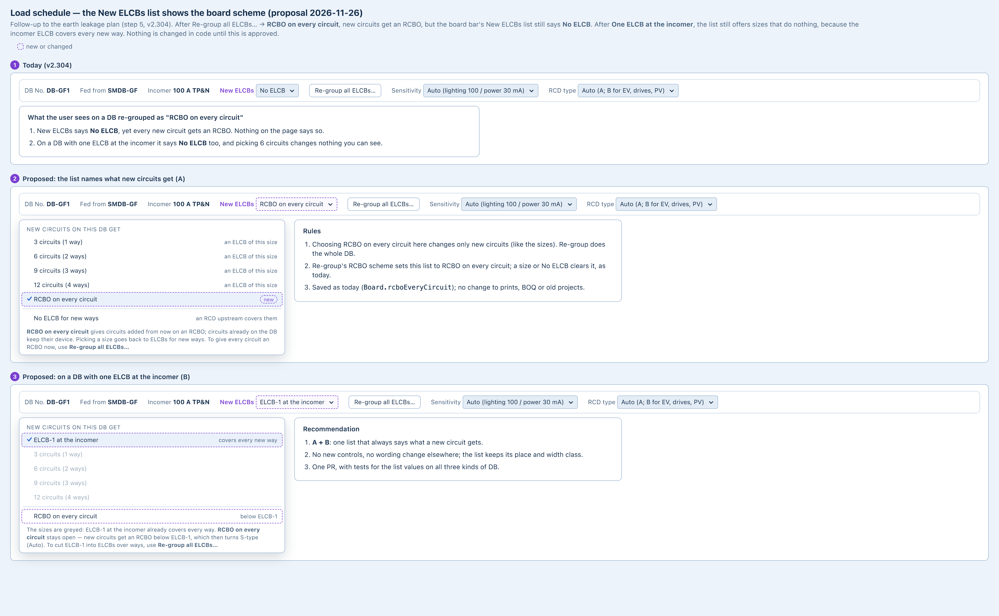

# UI UX proposal – Load schedule: the New ELCBs list shows the board scheme (2026-11-26)

Status: **approved on 2026-11-26** ("go with recommended": A + B). Built in v2.313; the list is a drop-down, so the footer text is its hover tip. Follow-up to the earth leakage plan (`UI UX proposals - 2026-11-23 - Load schedule earth leakage.md`, step 5, v2.304).

## The problem

- After Re-group all ELCBs… → **RCBO on every circuit**, new circuits get an RCBO (`Board.rcboEveryCircuit`), but the board bar's **New ELCBs** list shows **No ELCB**. Nothing on the page says what a new circuit will get.
- After **One ELCB at the incomer**, the list also shows **No ELCB**, and picking a size changes nothing visible, because the incomer ELCB already covers every new way.

## Proposal

- **A.** Add **RCBO on every circuit** to the New ELCBs list, after the four sizes and before No ELCB. Like the sizes, choosing it changes only circuits added from now on; Re-group still does the whole DB. Re-group's RCBO scheme shows it as chosen; a size or No ELCB clears it, as today.
- **B.** On a DB with one ELCB at the incomer the list shows **ELCB-1 at the incomer** (chosen). The four sizes are greyed, with a note that ELCB-1 covers every way. RCBO on every circuit stays available: new circuits then get an RCBO below ELCB-1, which turns S-type (Auto).

Recommendation: **A + B**. No new controls, no wording change elsewhere, nothing printed changes, and old projects open as before (the stored data is unchanged).

## Decisions

1. A + B as recommended, A only, or neither?
2. The list's footer text (as in the mockup), or no footer?

## Build (one PR, after approval)

`LoadScheduleView.tsx` (the New ELCBs select), a small model setter for the RCBO choice next to `setNewElcbSize` in `src/model/elcbs.ts`, and tests for the list on a DB with sizes, with RCBO on every circuit, and with an ELCB at the incomer.
